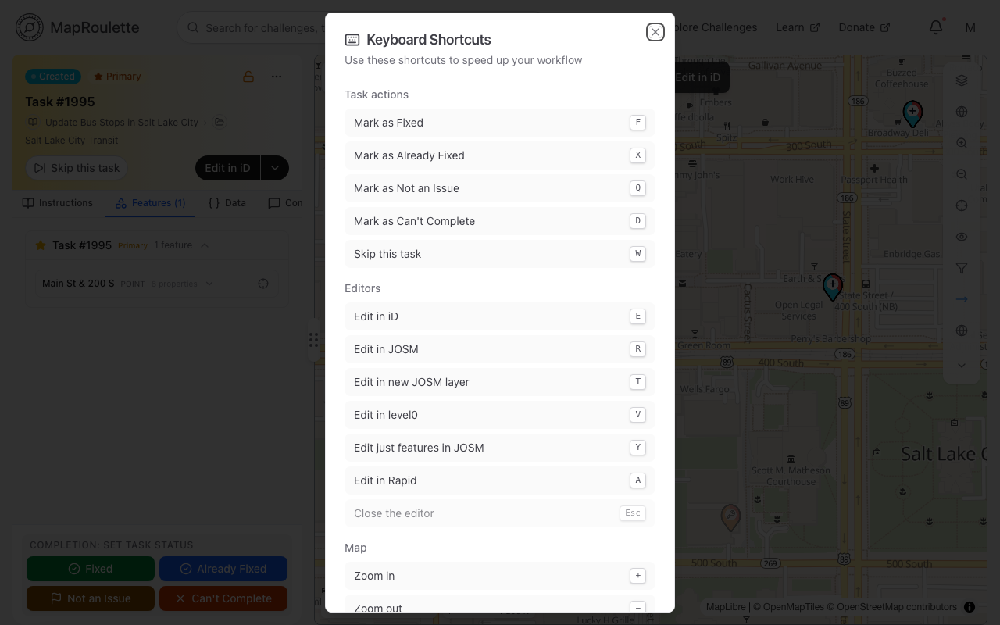
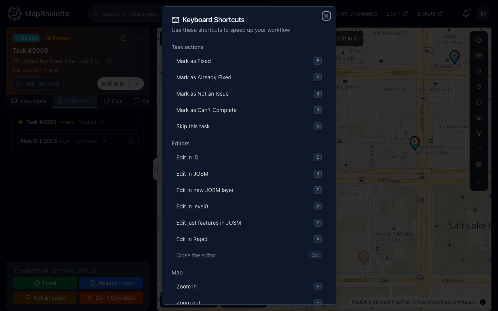

A number of keyboard shortcuts are available throughout the website. The latest shortcuts can always be seen for the current step by pressing `?`.

{: .only-light}
{: .only-dark}

At the time of writing, the following shortcuts are available:

| Key         | Action                                      |
| :---------- | :------------------------------------------ |
| +           | Zoom in map                                 |
| -           | Zoom out map                                |
| 0           | Fit map to task features                    |
| m           | Show or hide task markers                   |
| Shift + o   | Show or hide tasks from other challenges    |
| s           | Toggle direction indicators on task geometry |
| e           | Edit in iD [^1]                             |
| r           | Edit in JOSM [^1]                           |
| t           | Edit in new JOSM layer [^1]                 |
| y           | Edit just features in JOSM [^1]             |
| v           | Edit in Level0 [^1]                         |
| a           | Edit in Rapid [^1]                          |
| f           | Fixed [^1]                                  |
| q           | Not an Issue [^1]                           |
| x           | Already Fixed [^1]                          |
| d           | Can't Complete [^1]                         |
| w           | Skip [^1]                                   |
| ESC         | Close the built-in editor                   |
| Shift + b   | Draw to select multiple tasks               |
| b           | Show only the selected tasks [^2]           |
| Del         | Work on the primary task only [^2]          |
| Ctrl/⌘ + k  | Open the search box                         |
| ?           | Show keyboard shortcuts                     |

[^1]: shortcut is only available after editing has been initiated
[^2]: shortcut is only available while more than one task is selected
