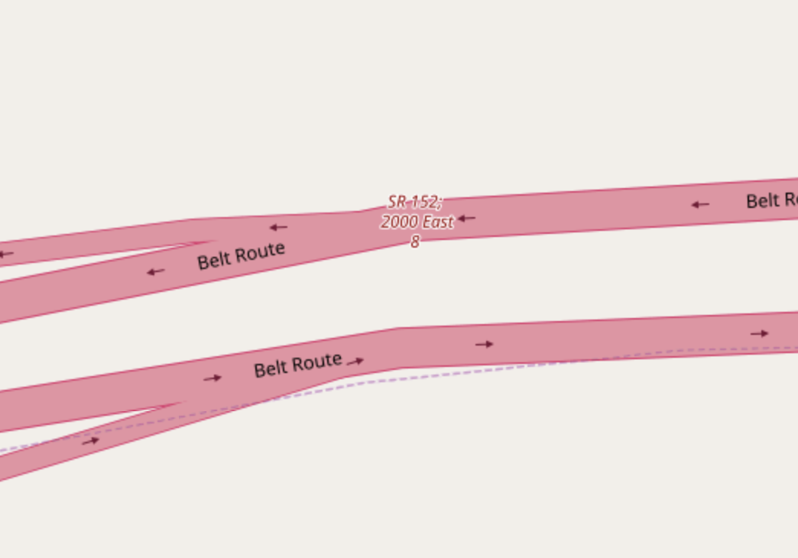
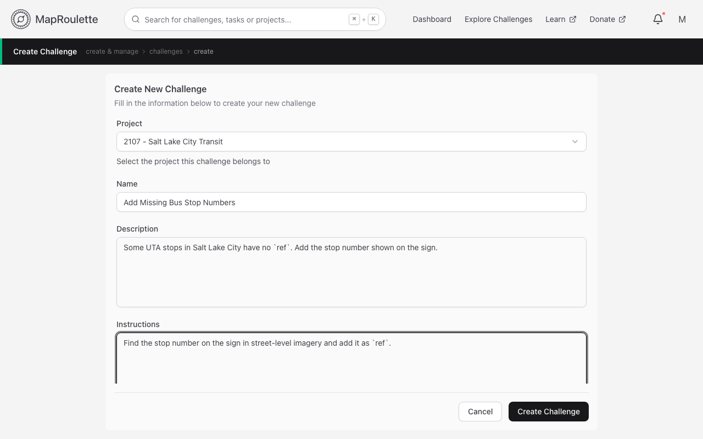
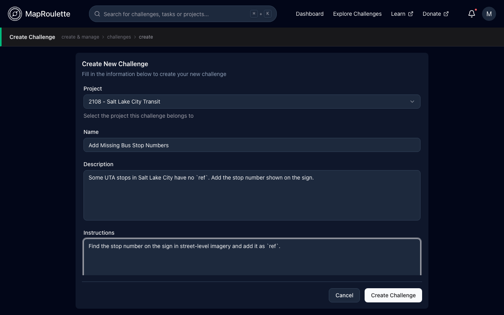
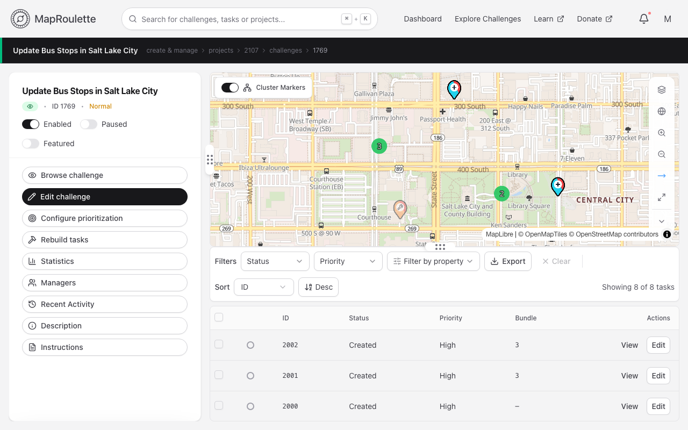
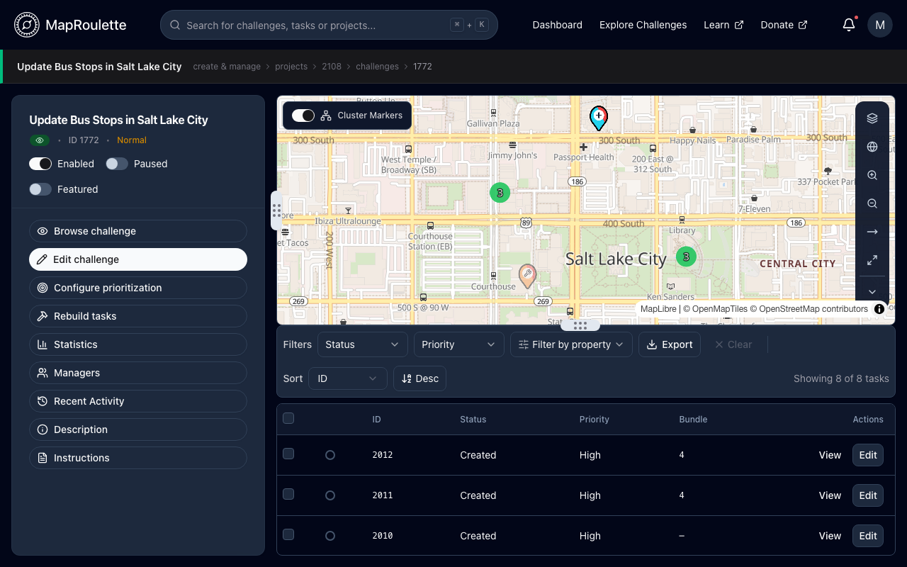

Creating a challenge starts with a good challenge idea. Good challenges have tasks that:

- Are easy to solve (typically less than one minute)
- Do not require local knowledge
- Involve only one or two OSM objects

Here's an [example challenge](https://maproulette.org/browse/challenges/3253) that meets that criteria. We will ask mappers to review `motorway_junction` nodes in the United States that have name `tags`. This is uncommon in the U.S. Often mappers will add a name tag that has the destination information on it, so the information renders on the map:



This [Overpass query](https://overpass-turbo.eu/?Q=area%5Bname%3D%22United%20States%20of%20America%22%5D-%3E.a%3B%0Anode%5B%22highway%22%3D%22motorway_junction%22%5D%5B%22name%22%5D(area.a)%3B%0Aout%20meta%3B%0A&C=40.66202;-111.87756;12) selects all these nodes.

```
area[name="United States of America"]->.a; node["highway"="motorway_junction"]["name"](area.a); out meta;
```

With that query in hand, open the user menu and choose **Manage**, then **Projects**. Challenges live inside projects, so if you don't have one yet, click **Create Project**. Otherwise open the project that should hold your new challenge and click **Create challenge**.

{: .only-light}
{: .only-dark}

At the top you enter the title, description and instruction for your challenge, as well as some metadata that will be used to help others find it and identify edits made by mappers using the Challenge:

- **Name** A descriptive name for the challenge. I used Review named motorway junctions in USA. A good title describes what the challenge is about in a few words.
- **Description** Some text to describe in more words what the challenge is about. This field supports markdown and appears on the challenge page when mappers browse for interesting challenges:

I used Motorway junction nodes are not commonly tagged with name. This challenge asks mappers to review those nodes, removing the name where it's not applicable.

- **Instructions** This is perhaps the most important text. Here you tell mappers exactly what the task is you want them to perform. Be specific and use links (this field supports markdown as well) to the OSM wiki or other external sources where needed. This text is shown next to the map of the task location. I used This `motorway_junction` node has a `name` tag. This is uncommon, [see the OSM wiki](https://wiki.openstreetmap.org/wiki/Tag:highway=motorway_junction#Name_and_number) for details. If this name tag does not represent a 'name of the junction or interchange', the name tag should be removed. If you're not sure, you can skip the task. Note how I use markdown features to make the instructions easy to read and comprehensive.
- **Changeset Comment** This field will be used to pre-fill the changeset comment in the editor ( A URL linking to the task is automatically added to the changeset comment, but only when the challenge is discoverable ). I used reviewing named motorway junctions. A `#maproulette` hashtag will be added if it's missing. The comment can include [mustache tags](/documentation/mustache-tag-replacement/) referencing task properties.
- **Changeset Source** This field will be used to pre-fill the changeset source field in the editor. If your task involves using any external data, you should list it here. I used maproulette;overpass.
- **Difficulty** You can leave this at 'Normal' unless your tasks are particularly easy or hard.
- **Category** This helps the user find challenges they are interested in. There is a dropdown menu on the main Challenge list that lets users narrow down the list by category. For this challenge I used Roads / Pedestrian / Cycleways.
- **Keywords** These also help users find interesting challenges. I used `junction`, `name`, `motorway` and `exit`.

When all this is filled out, further down the form you supply the source data for the tasks. This can be a GeoJSON file or URL, or an Overpass query. If you use an Overpass query, make sure you don't use any Overpass Turbo specific language such as `geocodeArea:...`. Test your query in Overpass Turbo first. See [Using Overpass to create Challenges](/documentation/using-overpass-to-create-challenges/) for more. Make sure that the query only returns the nodes or ways that you want mappers to review, and ideally the number of objects returned should be no more than a couple thousand.

The rest of the form is optional: a [team](/documentation/teams/) to own the challenge, a [basemap](/documentation/setting-basemap-for-challenge/), and the [task identifier](/documentation/setting-external-task-identifiers/) property. Finally, confirm that you have read OpenStreetMap's [Automated Edits code of conduct](https://wiki.openstreetmap.org/wiki/Automated_Edits_code_of_conduct).

When you click **Create Challenge**, MapRoulette will query Overpass in the background and populate your challenge. Depending on how heavy the Overpass query is, this can take a few seconds to a couple of minutes. When it finishes, you will see a map with your tasks, a complete list of tasks and some more challenge information.

{: .only-light}
{: .only-dark}

You can now click **Browse challenge** to go directly to your challenge and try it out!
