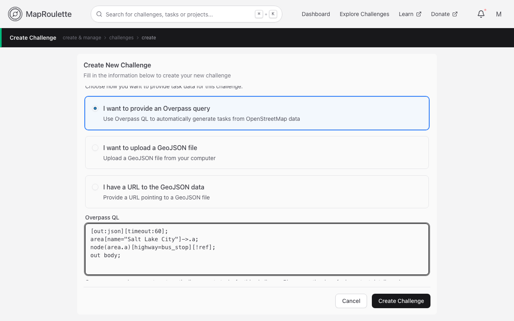
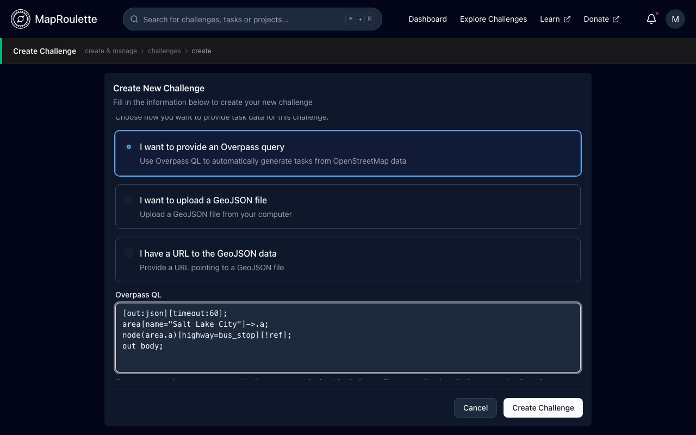

Overpass is a powerful query language for OSM. You can ask it things like "Show me all water fountains in Rome" or "Show me banks that are more than 1km away from a police station".

You can use Overpass queries directly in MapRoulette to generate tasks when you create a new Challenge. This page is here to help you do this, and avoid common mistakes.

### A simple example

Imagine that you want to create a Challenge to have mappers look at bus stop nodes in a certain area. [This Overpass query](http://overpass-turbo.eu/s/Wh4) will give you all `highway=bus_stop` nodes in Salt Lake City:

```
area[name="Salt Lake City"]->.a;
node[highway=bus_stop](area.a);
out meta;
```

Explaining the full syntax of Overpass QL (the language this query is written in) is outside the scope of this article. Please look at the [language reference](https://wiki.openstreetmap.org/wiki/Overpass_API/Overpass_QL), [examples](https://wiki.openstreetmap.org/wiki/Overpass_API/Overpass_API_by_Example) and other Overpass related pages on the OSM wiki. OSM user Binette also has some [MapRoulette specific query examples](https://wiki.openstreetmap.org/wiki/User:Binnette/OverpassQueries) on their user page.

You can plug this query right into MapRoulette when you create a Challenge:
paste it into **Overpass QL** in the challenge form's **Task data** section,
after choosing **I want to provide an Overpass query**.

Once you submit the form, MapRoulette runs the query in the background and your
Tasks reflect its result.

{: .only-light}
{: .only-dark}

## Common Pitfalls

### `out center` returns both relations and ways as nodes; use `out geom` instead

`out center` returns the correct coordinates, but instead of relations and ways, nodes are returned. This causes issues with editors because instead of searching for a `way` with `id = 9817324213`, we search for a `node` with `id = 9817324213`. This also causes problems with the MapRoulette maps as a single point will be displayed instead of a linestring.

### Settings statements

MapRoulette adds `[out:json]` and a `[timeout:]` setting to your query when
they're missing. If the first line of your query is a settings statement (it
starts with `[` and ends with `;`), MapRoulette keeps it and only adds whichever
of the two is missing. Otherwise, if the query contains no settings anywhere, it
puts `[out:json][timeout:...];` on a new first line; if it finds settings
elsewhere in the query (for example after a leading comment, or split across
lines), it leaves the query unchanged.

Keep any settings on the first line, before any comments. Don't ask for a
different output format such as `[out:xml]`: MapRoulette needs JSON, and the
challenge fails to build otherwise.

### `{{bbox}}`

This indicates the currently visible map extent. Overpass Turbo replaces this with the actual longitude / latitude bounds before sending the query to Overpass. If you want to use a query that contains `bbox`, you need to select `Export` > `Query` > `Copy as standalone query` before pasting into MapRoulette.

### Beware of Recursions

Overpass lets you use recursion (`>`) to select all nodes belonging to a way, or all nodes and ways belonging to a relation. If you use recursion in a query to create Tasks in MapRoulette, you will often get more results than you expected. This is because MapRoulette will interpret each separate node as a Task, as well as the Way itself. To avoid this, use `out geom`. So instead of...

```
way["highway"="path"](40.76,-111.90,40.81,-111.85);
out body;
>;
out skel qt;
```

... do this:

```
way["highway"="path"](40.76,-111.90,40.81,-111.85);
out geom;
```

### The query can't be edited later

A challenge's Overpass query can be changed by editing the challenge only until
the challenge has tasks; after that, editing shows it read-only. To change what
the query returns, use [Rebuild
Tasks](/documentation/rebuilding-challenge-tasks/), which re-runs it against
current data.

### Timeouts

Complex queries or queries that span a large area can take a long time to complete. MapRoulette uses a default query timeout of 120 seconds (2 minutes). This should be enough for most scenarios. If you really need MapRoulette to tell Overpass to wait longer, you can use [Overpass's native `[timeout]` setting](https://wiki.openstreetmap.org/wiki/Overpass_API/Overpass_QL#timeout:) to override this.

### A word on `out meta`

Strictly speaking, you don't need all OSM metadata to build the tasks. You can just use the `out` statement with no parameters which, according to the documentation, gives you "all information necessary to use the data". By using `out meta` you get "everything output by body for each OSM element, as well as the version, changeset id, timestamp, and the user data of the user that last touched".

