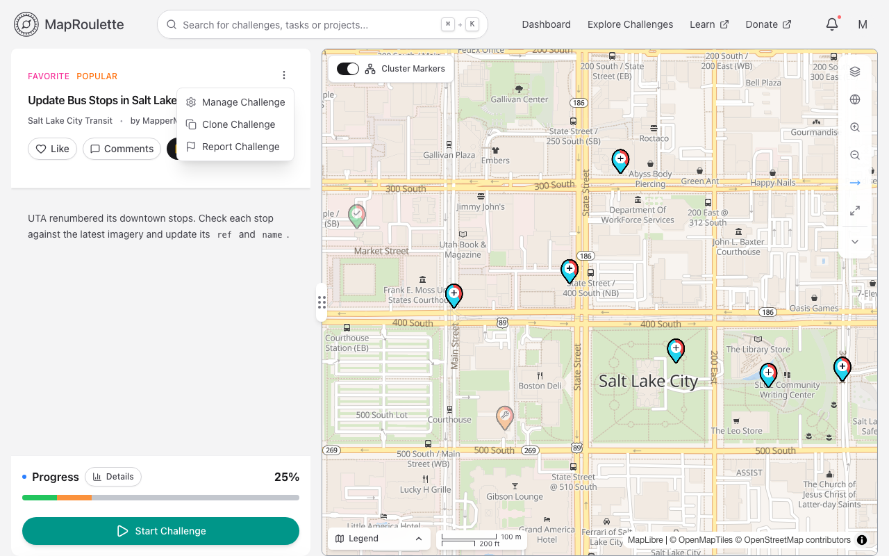
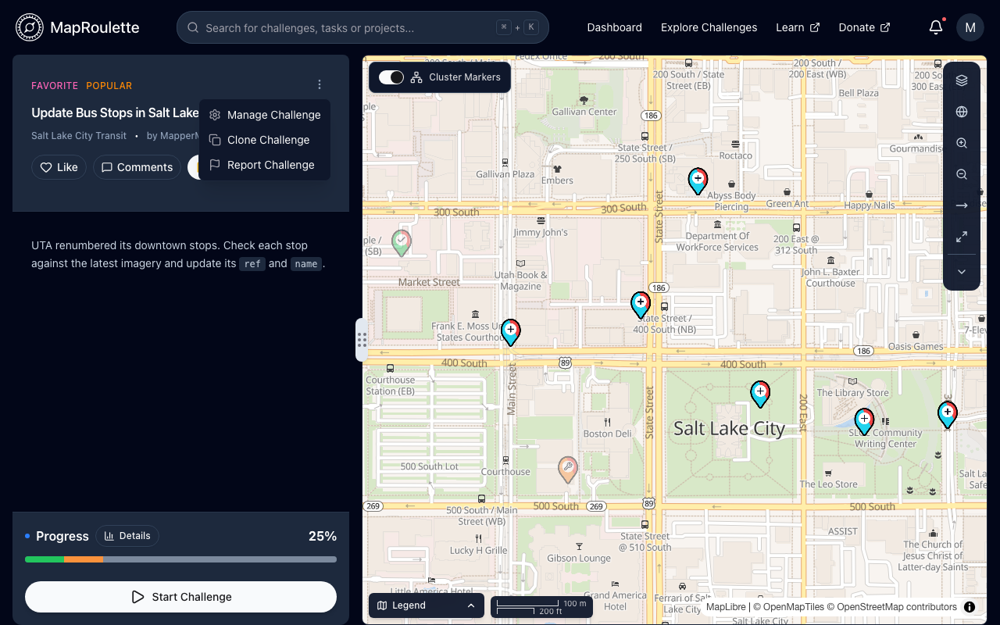
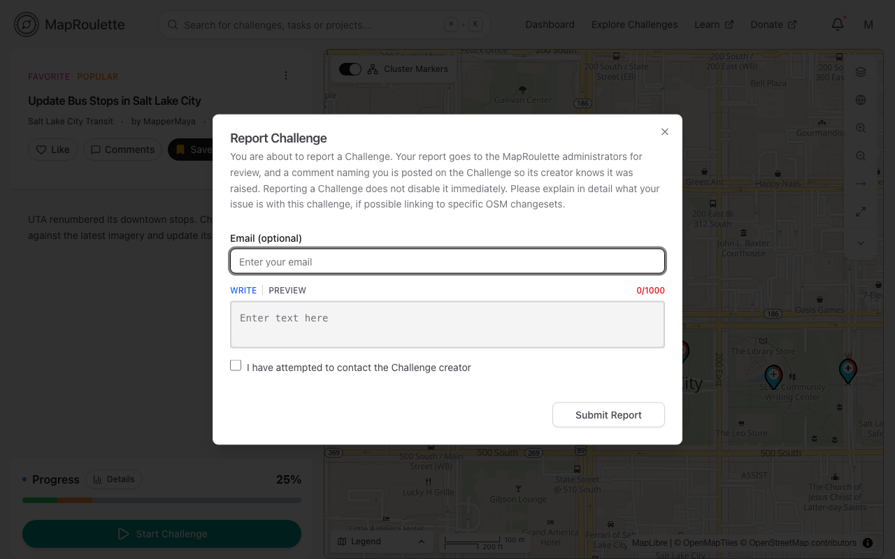
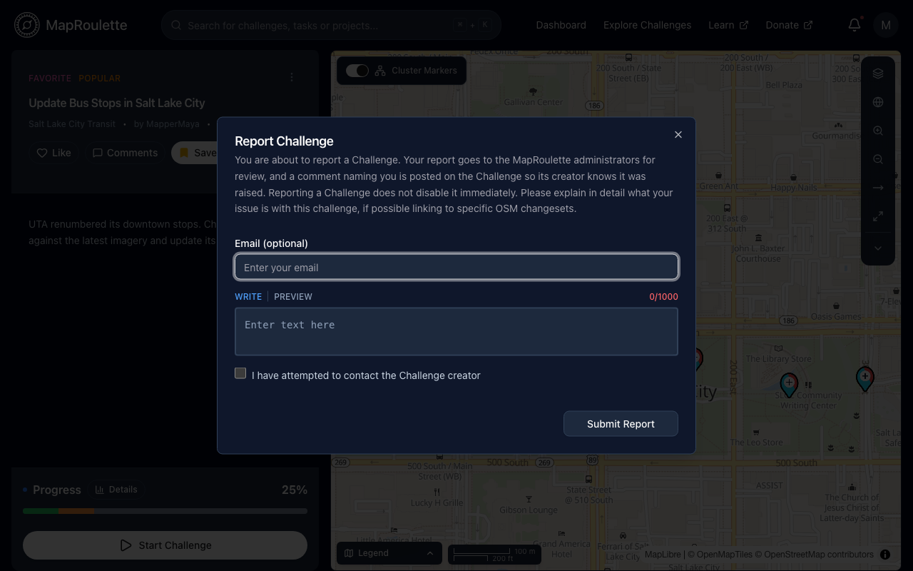
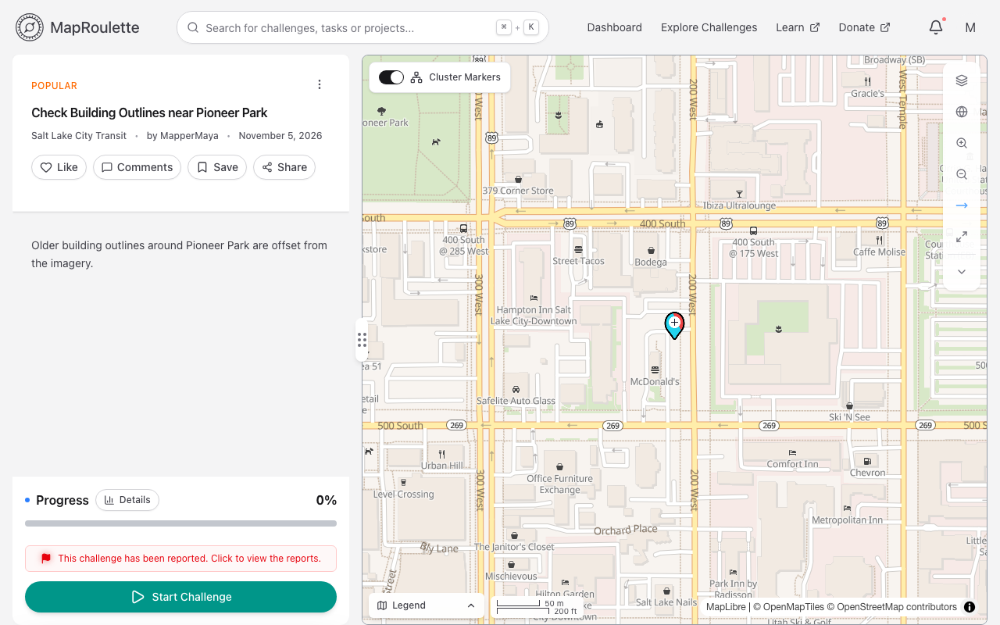
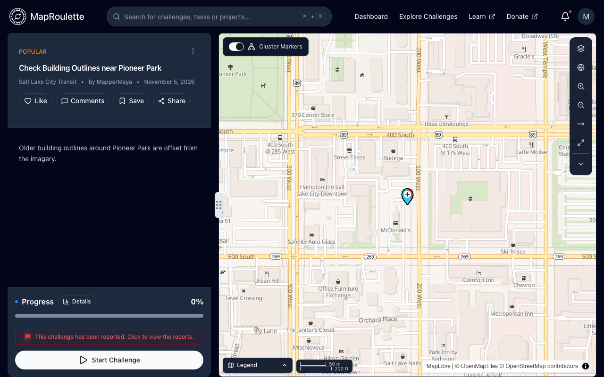
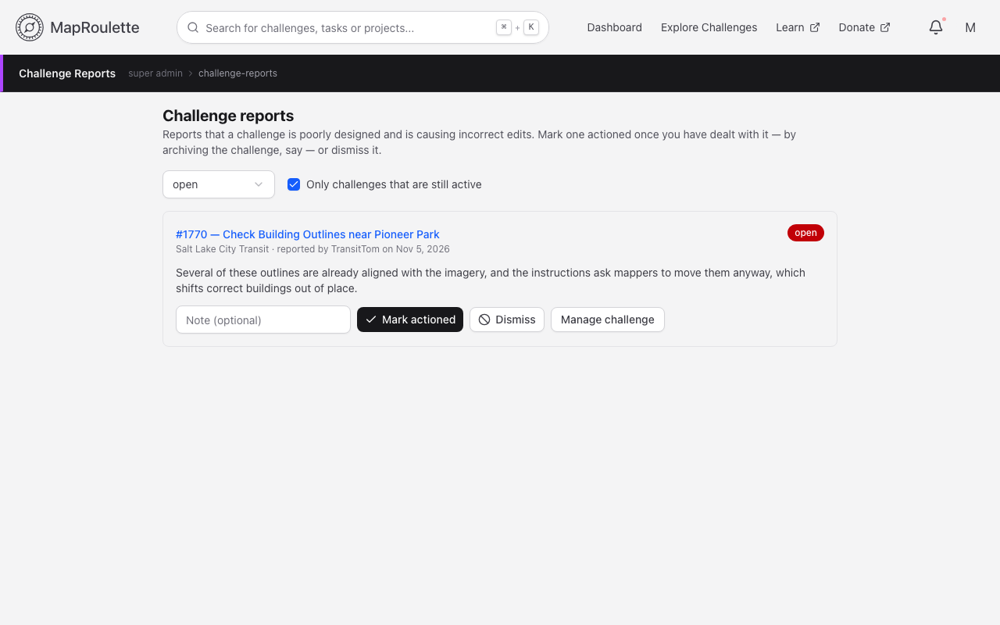
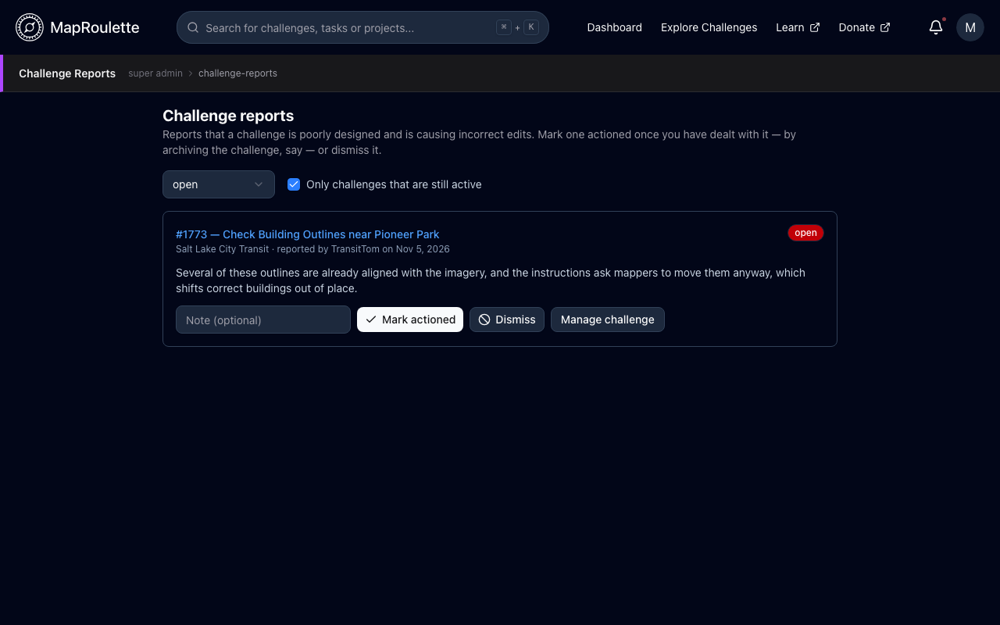

Reporting a challenge lets mappers escalate a challenge that did not meet
quality standards, when talking to its owner hasn't resolved things. The report
goes to the MapRoulette administrators, who decide what to do about it.

> Reporting is one of a set of features for reaching out to challenge owners,
> and it is rarely the first one to reach for. Please review the recommended
> order of steps in [Reporting A
> Challenge](/documentation/reporting-a-challenge/) first.

## Filing a report

Open the challenge page and select the **Challenge actions** menu (the ⋮
button beside the challenge title), then **Report Challenge**. You need to be
signed in.

{: .only-light}
{: .only-dark}

The report dialog asks for:

- **Email (optional)** — so the administrators can reach you about the report.
  It is prefilled with the address in your own settings, and is only ever
  shown to administrators
- **A description of the issue** — between 100 and 1000 characters, so explain
  in detail what your issue is with this challenge, linking to specific OSM
  changesets where you can. The field supports
  [Markdown](/documentation/markdown/), with **Write** and **Preview** tabs and
  a character counter
- Confirmation that **you have attempted to contact the Challenge creator**

Choose **Submit Report**. Submitting the report:

1. files the report with the MapRoulette administrators for review; and
2. posts a comment on the challenge, naming you as the reporter, so the owner
   and other mappers know the concern was raised and can join the discussion.

Reporting a challenge does **not** disable it immediately, and it does not
archive or hide it. Any follow-up discussion happens in the [challenge
comments](/documentation/challenge-comments/).

{: .only-light}
{: .only-dark}

## After reporting

While your report is awaiting review, the actions menu shows **Challenge
Reported** with a red flag instead of **Report Challenge**, and the item is
disabled — there is nothing more for you to do until an administrator has
looked at it. You can report the same challenge again once your earlier report
has been dealt with.

{: .only-light}
{: .only-dark}

Reports aren't private. While a challenge has a report awaiting review, its
page shows **This challenge has been reported. Click to view the reports.**
beneath the progress bar, for everyone. That opens **Reports on This
Challenge**, which lists every report filed against the challenge, resolved
ones included, each as **Reported by _user_ on _date_** with its description
and where it stands: awaiting review, or marked **Actioned** or **Dismissed**
on a given date. The email address a reporter gave and the administrator's note
are never shown there.

## What administrators do with it

{: .only-light}
{: .only-dark}

Reports land in a review queue under **Super Admin → Challenge Reports**, where
an administrator reads the report, can jump straight to the challenge or its
management page, and closes the report out as either:

- **Actioned** — the concern was valid and something was done about it, such as
  archiving the challenge or asking the owner to change it
- **Dismissed** — no change was warranted

Either decision can carry a short note recording what was decided. See [Super
Admin](/documentation/super-admin/) for the administrator's side of the queue.

> Reports used to be filed as public issues in a GitHub repository, and the
> challenge actions menu offered a **View reported issue on GitHub** link
> afterwards. Reports are now held in MapRoulette itself, which keeps the
> reporter's email address private and puts the triage in the hands of the
> administrators of the installation you are using. The [blog post that
> introduced the
> feature](https://blog.maproulette.org/2023/01/23/introducing-our-flag-report-a-challenge-feature/)
> describes that original GitHub-based version.
{: .legacy}

We hope the report feature helps maintain and improve the overall quality of
challenges on MapRoulette by giving our users the ability to regulate them.
