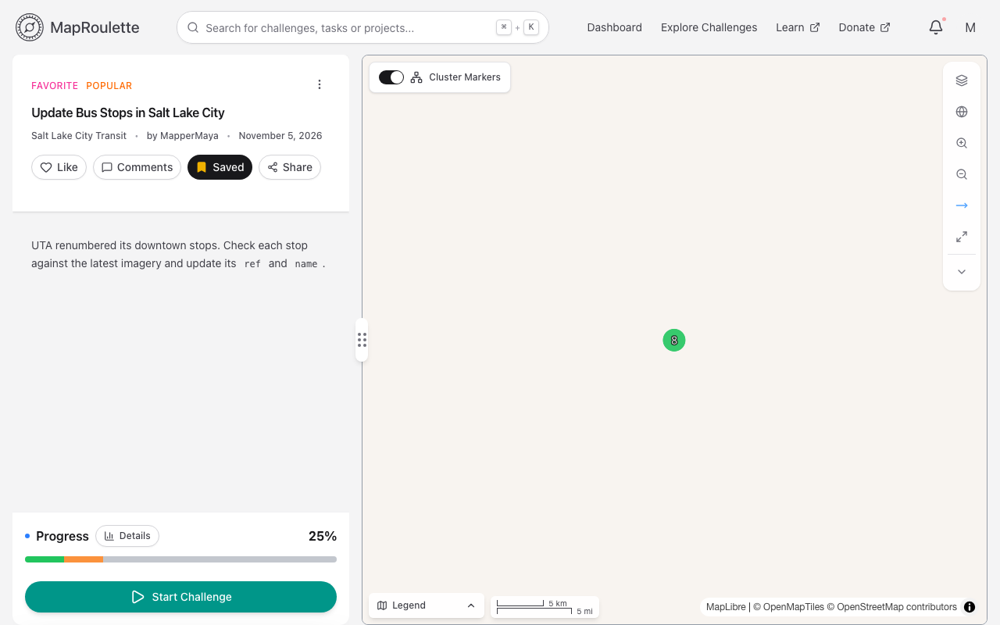
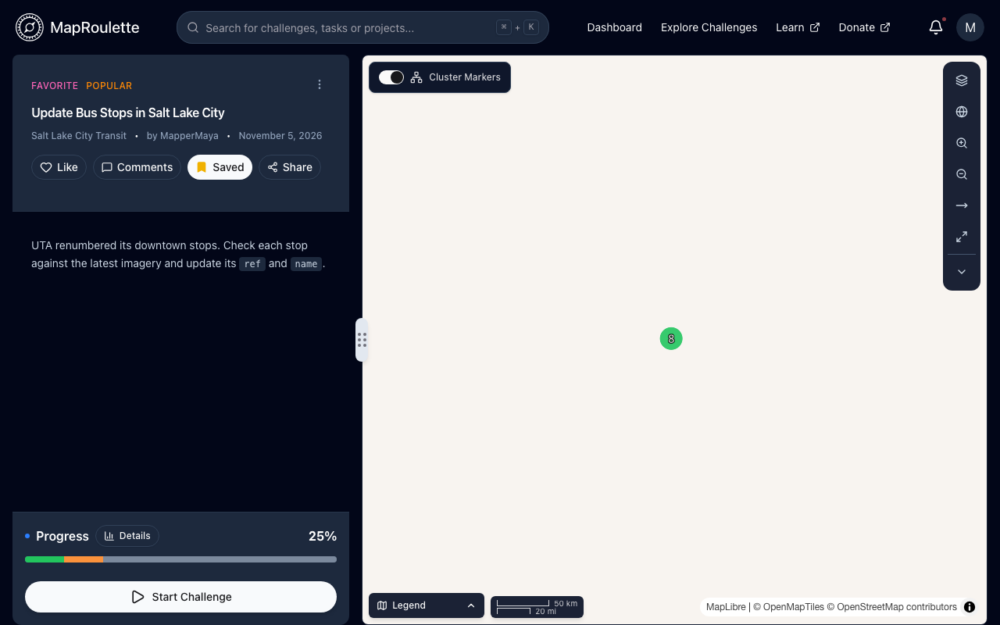

From time to time, a Challenge is created in MapRoulette that is poorly designed. The instructions may be unclear or even tell mappers to 'fix' the map in a way that goes against OSM best practices and conventions. Bad Challenges have no place in MapRoulette and we want you to be confident that we will deal with them if we need to.

This page describes the steps you can take to resolve an issue with a MapRoulette Challenge. This process is a lot like the process you would follow when you notice a questionable edit in OSM made outside of MapRoulette.

### 1. Contact the Challenge owner

The first step is to contact the owner of the Challenge and explain the issue you encountered to them. Most of the time, you can have a constructive dialog with the owner and resolve the issue with them. Remember to assume good intent on the part of the Challenge owner and be respectful in your language.

To contact the owner, go to the challenge page and click on the owner's name beneath the challenge name. This takes you to their OSM profile, where you can send them a message through OSM's messaging system.

{: .only-light}
{: .only-dark}

If you can't come to an agreement on how to proceed, the next step is to get in touch with us.

### 2. Comment on the Challenge

You can raise awareness of a concern or item for a specific challenge using [Challenge Comments](/documentation/challenge-comments/). This feature not only helps create dialogue with the Challenge owner but all interested mappers wanting to assist.

### 3. Report Challenge

If reaching out to the challenge owner is proving unsuccessful, and there is continued concern of a challenge's integrity, please use the [Report Challenge](/documentation/challenge-flagging/) feature.

### 4. Contact us via email

If the Challenge owner does not respond in a reasonable time, or you can't come to an agreement on how to proceed, please get in touch with us by sending an email to maproulette@maproulette.org. Please include a link to the offending Challenge in your message, along with a short summary of the issue you encountered and what you have done to try and resolve it. We will then work directly with you and the Challenge owner (if we can reach them) to work it out.

We hope that with this, we have defined a clear and unambiguous process to deal with Challenges that lead to bad edits in OSM. Thanks for helping to keep MapRoulette a great place to find interesting tasks to help improve OSM!
