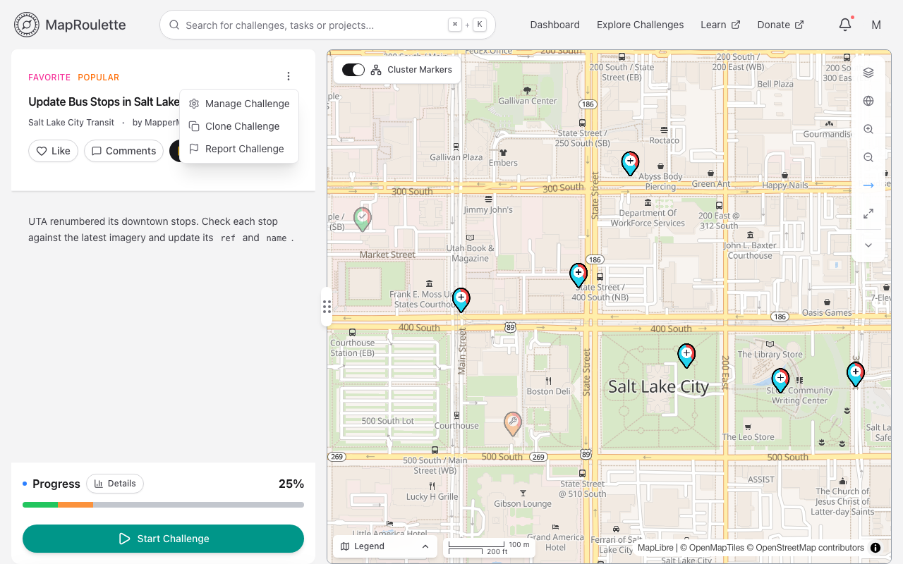
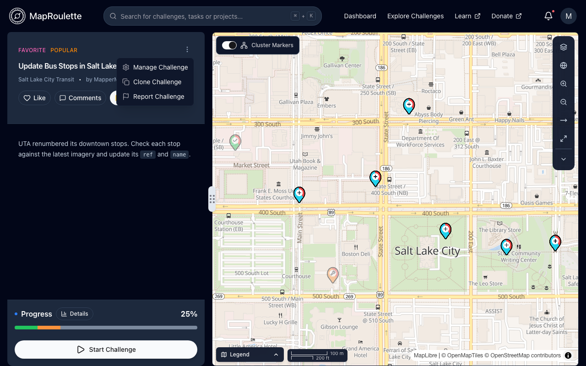
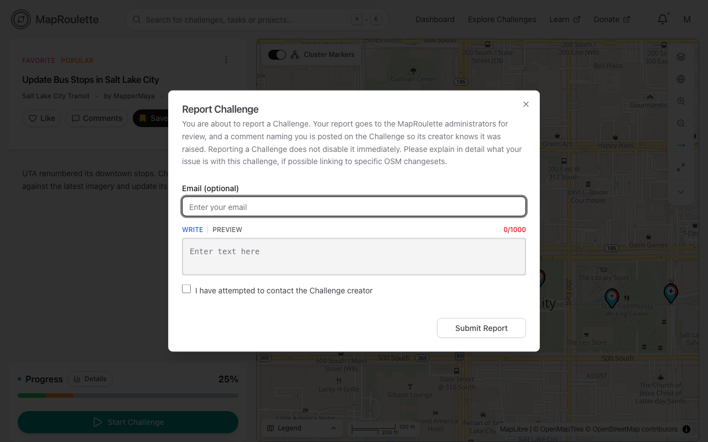
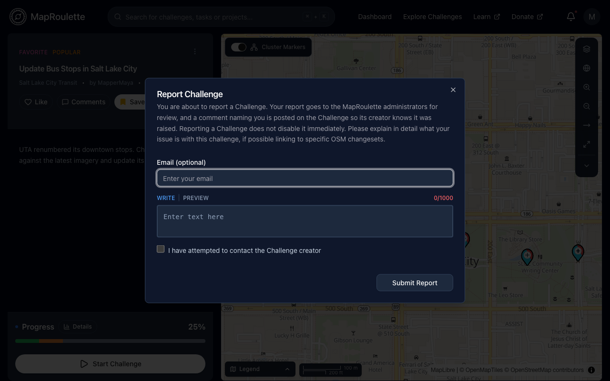
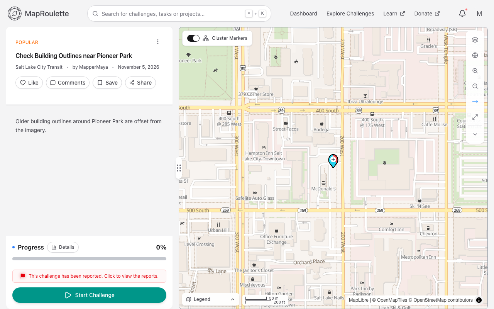
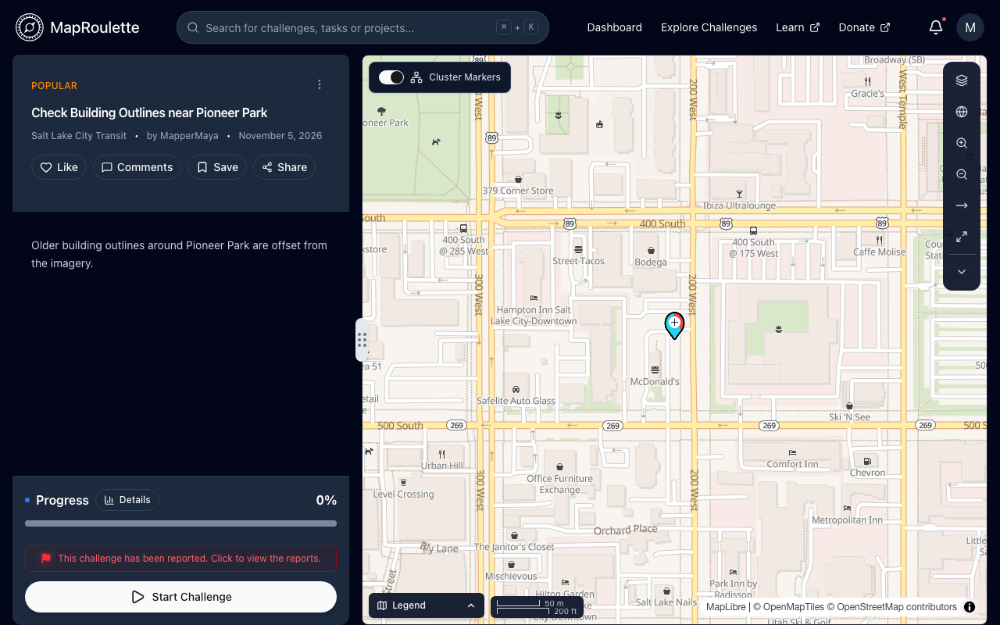

Challenge reporting allows mappers to report any questionable encounters within a challenge that did not meet quality standards. The report goes to the MapRoulette administrators for review.

See original post and credits on our blog [here](https://blog.maproulette.org/2023/01/23/introducing-our-flag-report-a-challenge-feature/)!

**Please be aware that Challenge Reporting is one of a set of features that assists mappers with reaching out to challenge owners.  Reporting a challenge may not be necessary, so please review the list of features and our recommendations for [Reporting A Challenge](/documentation/reporting-a-challenge/) depending on your specific needs.**

Upon coming across something we want to report in a challenge, go to the challenge details page that belongs to the challenge, there you will be able to see a menu next to the challenge name with a **Report Challenge** option.

{: .only-light}
{: .only-dark}

Simply click on Report Challenge, a modal will appear to report this challenge. Please include your email address (optional), a report description of at least 100 characters, and make sure you check \[I have attempted to contact the Challenge creator\] before proceed. Click on the \[Submit Report\] button to submit a report. This will generate a message in the comment section of this challenge. Reports filed before MapRoulette 4 are archived in MapRoulette’s [challenge-reports repository](https://github.com/maproulette/challenge-reports/issues) on GitHub.

{: .only-light}
{: .only-dark}

Once the challenge is being successfully reported, the menu item will read **Challenge Reported** with a red flag icon.

The challenge page also shows a notice that links to the reports filed against it.

{: .only-light}
{: .only-dark}

You could also view information related to this issue in the comment section of this challenge( by clicking on Comments).

Please note that only logged in user is able to report a challenge. And if you have already reported a challenge, you can only report the same challenge again once that report has been resolved.

We hope report feature will help maintain and improve the overall quality of challenges on MapRoulette by passing our users abilities to regulate.
