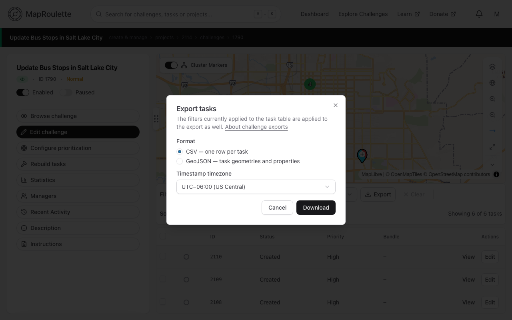
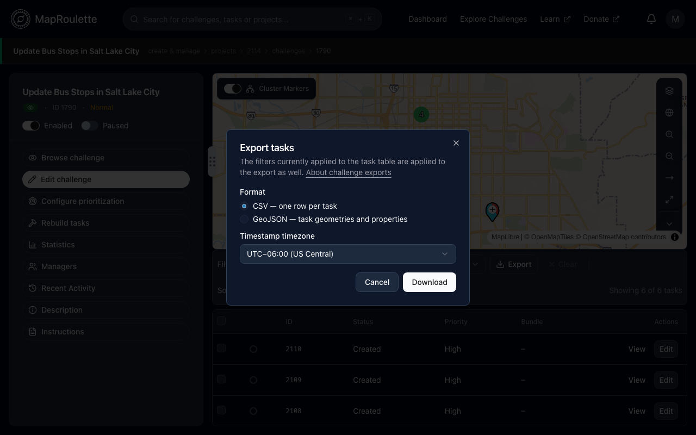
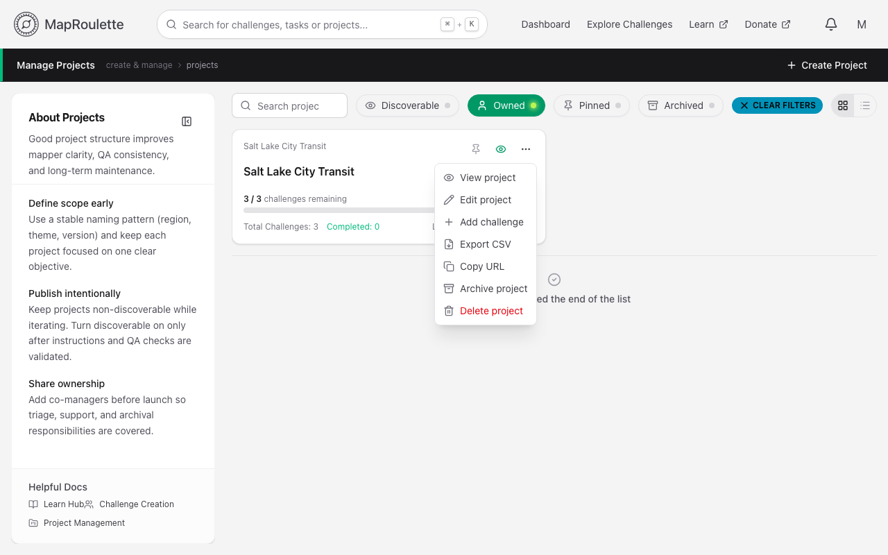
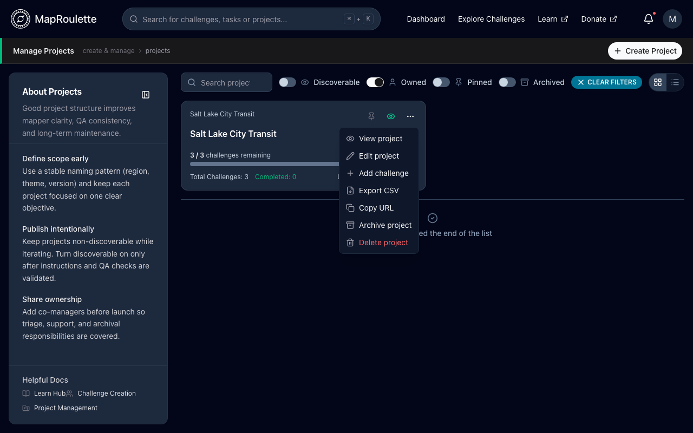

MapRoulette allows challenge managers to export their challenge data in either CSV format (suitable for spreadsheet applications) or as GeoJSON.

To export your data from the Challenge Management screen, simply click the **Export** button above the tasks table and choose one of the export formats. By default, all timestamps in the export are represented in your browser's timezone, but that can be customized on a per-export basis by selecting your desired timezone in the Export dialog prior to downloading.

The filters currently applied to the tasks table are applied to the export as well.

{: .only-light}
{: .only-dark}

You can also export the tasks of every challenge in a project as one CSV by choosing **Export CSV** from the project's menu on the Manage Projects page.

{: .only-light}
{: .only-dark}

