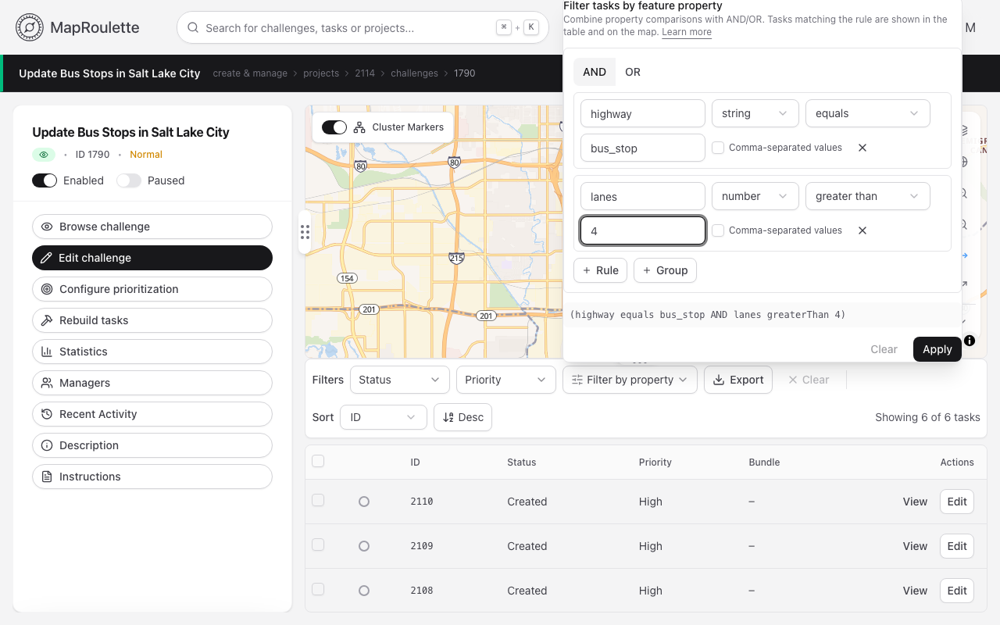
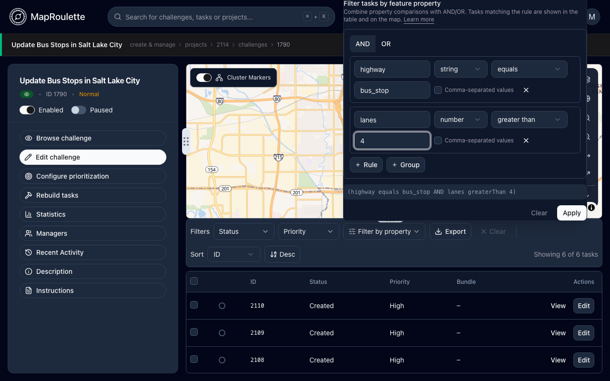

When analyzing your challenges as a manager, it can sometimes be useful to filter tasks by property values (such as OSM tags). MapRoulette lets you build filtering rules that can AND and OR together multiple properties to achieve fine-grained filtering.

When managing a challenge, you can get started by clicking the "Filter by property" control above the tasks table. Each rule asks for a property name, a value type (string or number), a comparison operator, and a value to compare against.

> Note: To help with choosing a property name, MapRoulette offers a dropdown of all property names it discovered on tasks in the challenge. It does **not** restrict the offered properties based on the data type you chose.

For example, if you were looking for motorways, you might choose the `highway` property, the `equals` operator, and then enter `motorway` for the value.

The comparison operators on offer depend on the value type you choose. Text properties can use textual operators like `equals` and `contains` while numeric properties can use operators like `equals` and `greater than` or `less than` for comparison:

| Value type | Operators |
|:-----------|:----------|
| string | `equals`, `does not equal`, `contains`, `exists`, `is missing` |
| number | `equals`, `does not equal`, `greater than`, `less than` |

> Note: it's important to choose the correct data types for the properties you're filtering against. However, if you have numeric data represented as strings in your GeoJSON (e.g. `population: "500"`), MapRoulette will attempt to perform numeric comparisons if you choose a Number type for the property despite it technically being a string/text.

If you simply wish to compare a property against multiple values (e.g. `highway` `equals` `motorway` or `trunk`), check "Comma-separated values" on the rule and enter `motorway, trunk`. These values will be OR'ed together.

If you wish to filter against multiple properties simultaneously, add more rules and choose whether to AND or OR them together. If you choose AND then _all_ property comparisons must match on a task for the task to be included in your filter results. If you choose OR then the task will be included if _any_ of the property comparisons match. For more involved filters you can nest groups of rules, each with its own AND/OR setting.

For example, if you wanted motorways with at least 6 lanes, you would set the first rule to string with `highway` `equals` `motorway`, add a second rule set to number with `lanes` `greater than` `5`, and choose to AND them together.

{: .only-light}
{: .only-dark}

Click **Apply** to filter the tasks table and map, or **Clear** to remove the filter.

