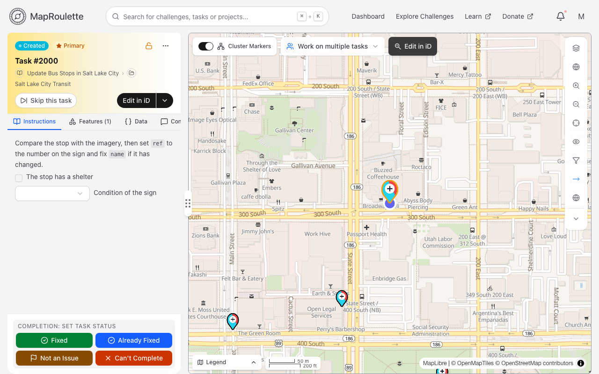
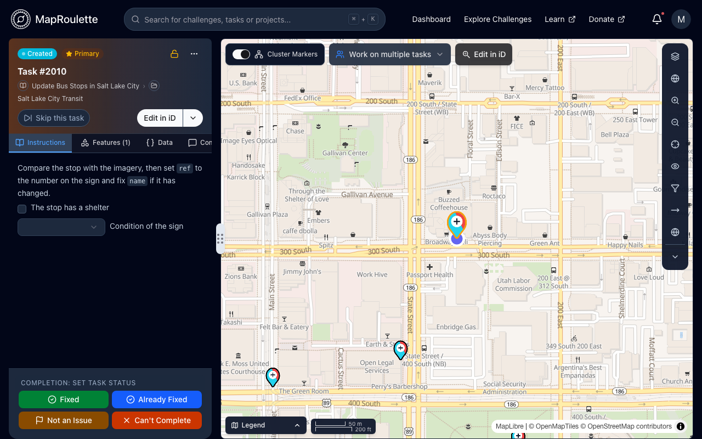

MapRoulette supports [mustache-tag replacement](/documentation/mustache-tag-replacement/) in Challenge Instructions (and a task's own instructions), as well as special short codes that can be used to embed basic form fields, make data easily copyable to the user's clipboard, etc.

## Basic Form Fields

It may occasionally be useful to allow mappers to provide to challenge managers some additional information as they work through tasks. MapRoulette supports special short codes that offer the ability to embed very basic form fields in Challenge Instructions (or a task's own instructions), which mappers can optionally complete for each task. Responses are included in CSV and GeoJSON [exports](/documentation/exporting-challenge-data/) of the challenge.

{: .only-light}
{: .only-dark}

To add form fields, simply use one or more of the short codes documented below in your Challenge Instructions. The short-codes will be replaced with inline form fields.

> Note: form fields used to be represented by three curly braces instead of as short codes using square brackets. That older notation is still supported for backwards compatibility with existing challenges, but is considered deprecated and should no longer be used

Form responses for each task will be automatically included in CSV and GeoJSON exports of challenge tasks from challenge management. In the exported CSV each field gets its own column, named `Recorded_` followed by the name you assign to the field (for example `Recorded_myCheckbox`). In the exported GeoJSON, a task's responses are stored together in an `mr_responses` property, keyed by field name.

### Checkbox field:

```
[checkbox "Your checkbox label" name="myCheckbox"]
```

This will create a checkbox field named myCheckbox

The label can also include basic markdown, including mustache tags referencing task or workspace properties

### Select (multiple-choice) field:

```
[select "Your select label" name="myDropdown" values="foo,bar,baz"]
```

Creates a select field named myDropdown with three choices (foo or bar or baz)

The label can also include basic markdown, including mustache tags referencing task or workspace properties

## Other Useful Short Codes

```
[copyable "some useful text"]
```

Causes a clipboard button to be rendered immediately after the specified text that, when clicked, will copy the text to the user's clipboard. The text can also include mustache tags referencing task or workspace properties, which will be substituted, but **cannot** include markdown.

References to OSM elements and map viewports, such as `[n123456789]` or `[v17/37.11777/126.99754]`, are turned into links. See [Short-codes in Comments](/documentation/comment-short-codes/) for the syntax.

