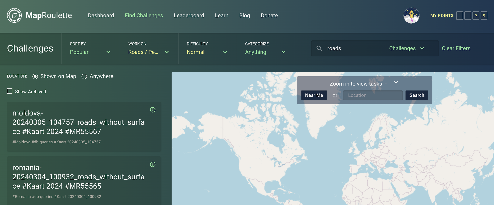

How do you find things that you are interested in fixing? MapRoulette offers a number of ways that we'll talk about on this page.

# Sorting

# Filtering

## By Topic

The creator of a Challenge will assign a Topic to it from a pre-defined list. For example, a Challenge that looks at fixing coastlines will have the topic 'Water', and a Challenge that looks at fixing the tagging of Burger King restaurants will fall under 'Points / Areas of Interest'. You can select one of these Topics to quickly narrow down the list to only show the relevant Challenges.

## By Difficulty

When someone creates a Challenge, they decide if this is an Easy, Medium, or Expert level Challenge. Tasks in an Easy Challenge should be fixable by mappers with little experience. Working on Expert level Challenges requires advanced mapping skills and intimate familiarity with OSM tagging practices.

## By Text or Id

## By Location

