How do you find things that you are interested in fixing? MapRoulette offers a number of ways that we'll talk about on this page.

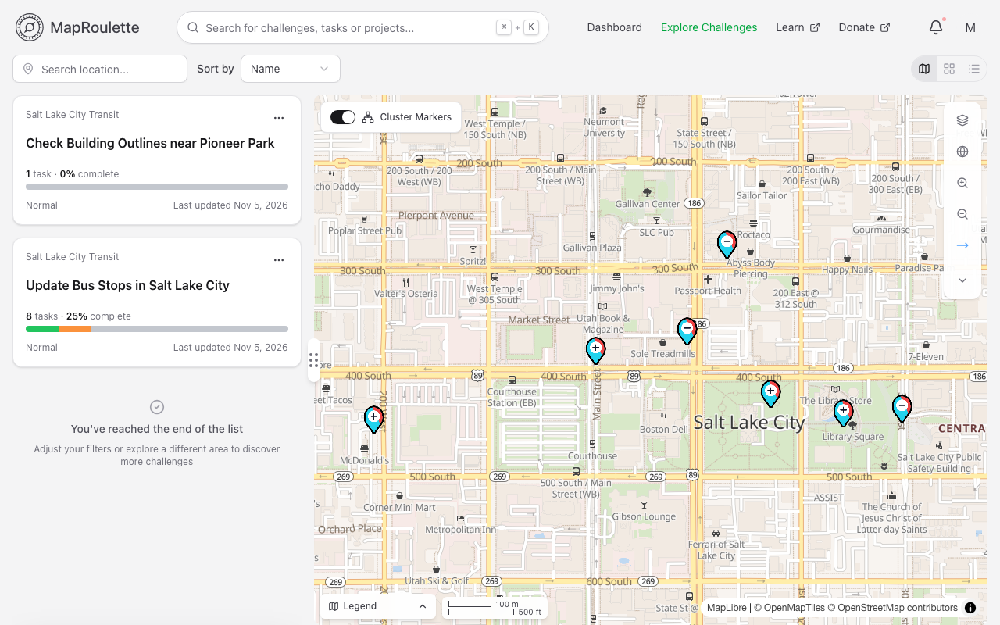{: .only-light}
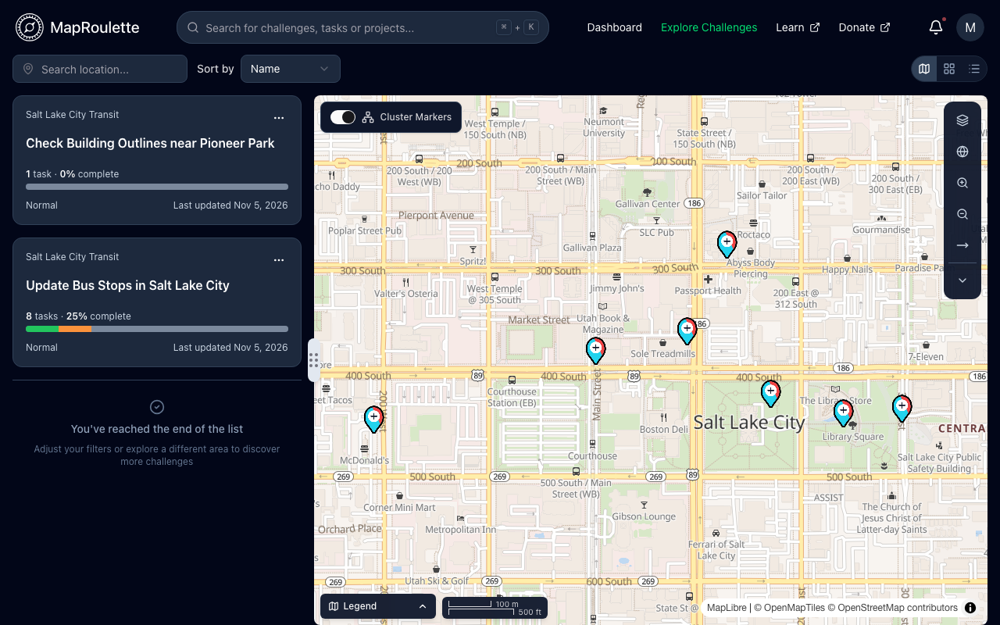{: .only-dark}

# Sorting

The Challenge list has a default sorting strategy that puts your saved Challenges, then Featured and Popular Challenges at the top of the list. Featured Challenges are interesting Challenges that are hand-picked by the OSM community, and Popular Challenges are the ones that have seen the most activity recently. You can use the **Sort by** dropdown menu at the top of the Challenge list to sort the list by other criteria.

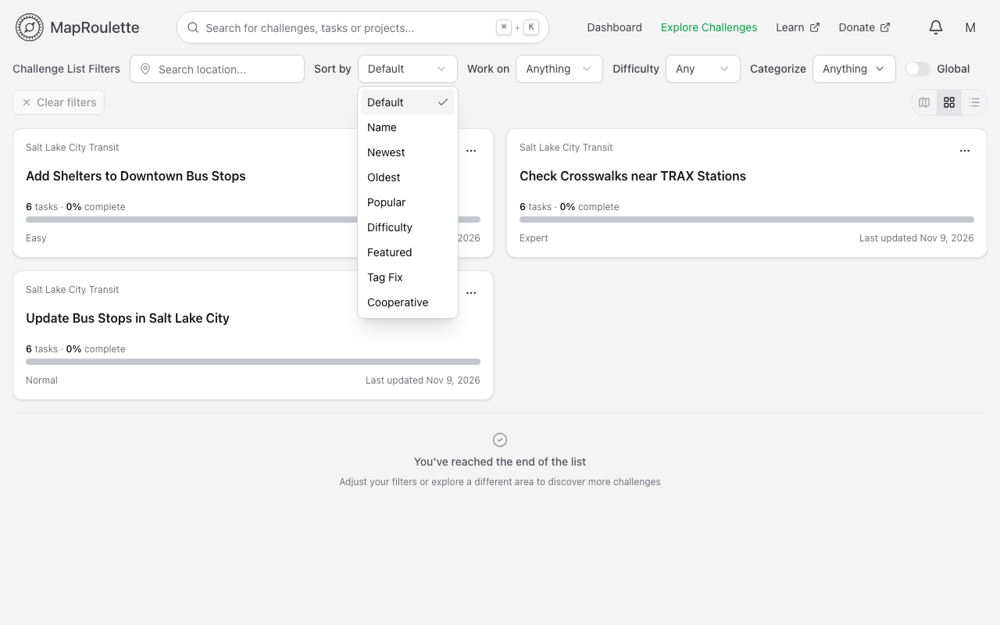{: .only-light}
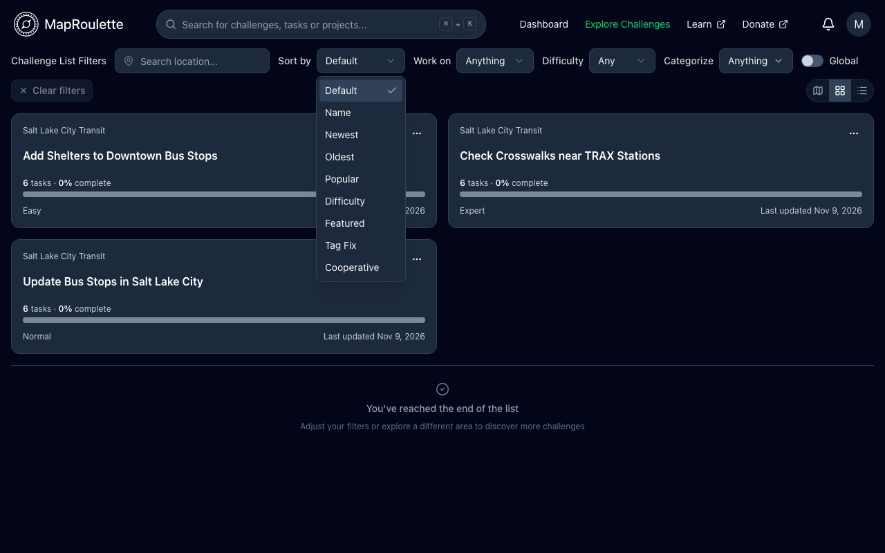{: .only-dark}

# Filtering

MapRoulette offers powerful filters to help you uncover Challenges you may be interested in. There are five types of filters at the moment: Topic, Difficulty, Custom Categorization Keywords, Text, and Location.

You can combine these filters as you wish. Topic, Difficulty, Custom Categorization Keywords and **Global** only apply when the list is shown without the map. Use the view buttons at the right end of the filter bar to switch between a grid with a map, a grid, and a list.

## By Topic

The creator of a Challenge will assign a Topic to it from a pre-defined list. For example, a Challenge that looks at fixing coastlines will have the topic 'Water', and a Challenge that looks at fixing the tagging of Burger King restaurants will fall under 'Points / Areas of Interest'. You can select one of these Topics in the **Work on** menu to quickly narrow down the list to only show the relevant Challenges.

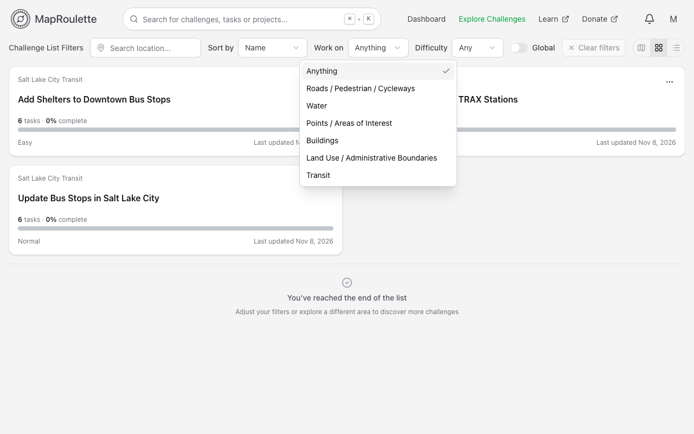{: .only-light}
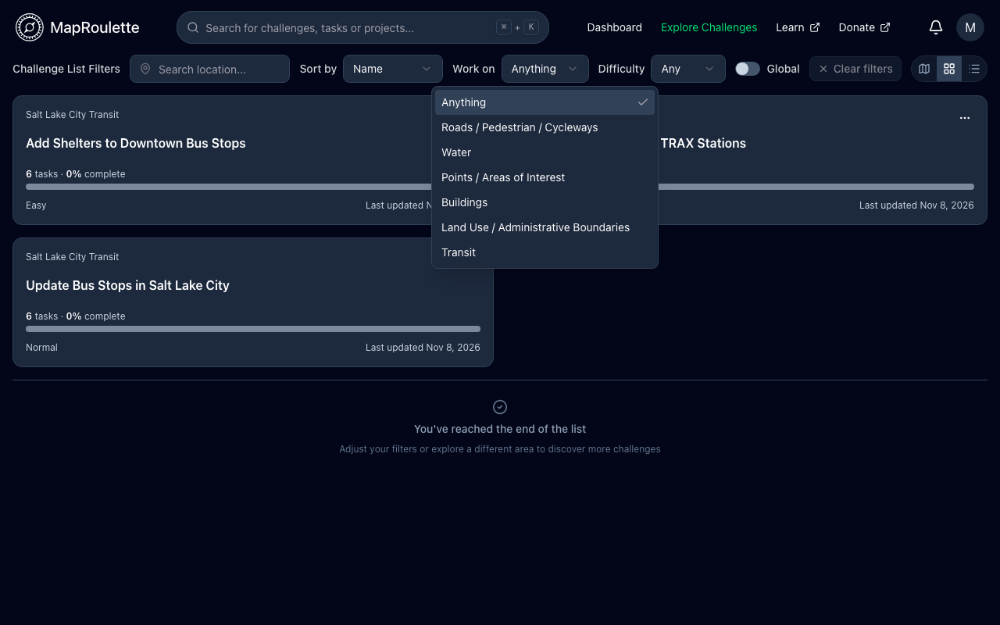{: .only-dark}

## By Difficulty

When someone creates a Challenge, they decide if this is an Easy, Normal, or Expert level Challenge. Tasks in an Easy Challenge should be fixable by mappers with little experience. Working on Expert level Challenges requires advanced mapping skills and intimate familiarity with OSM tagging practices.

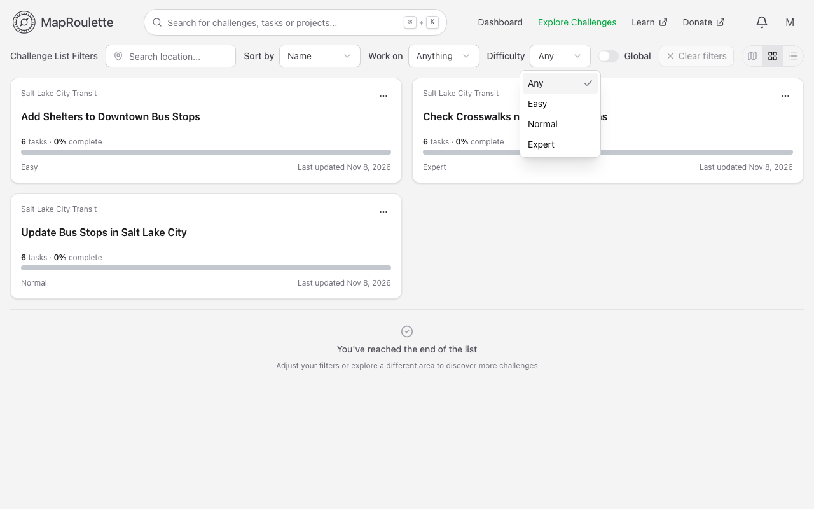{: .only-light}
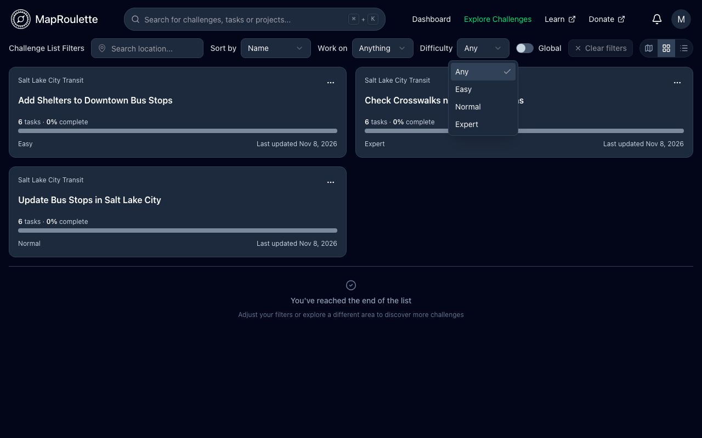{: .only-dark}

## By Custom Categorization Keywords

When a challenge is created, the challenge owner has the opportunity to create categorization keywords. This filter allows users to create custom keyword filters that can be used to filter for challenges with matching categorization keywords.

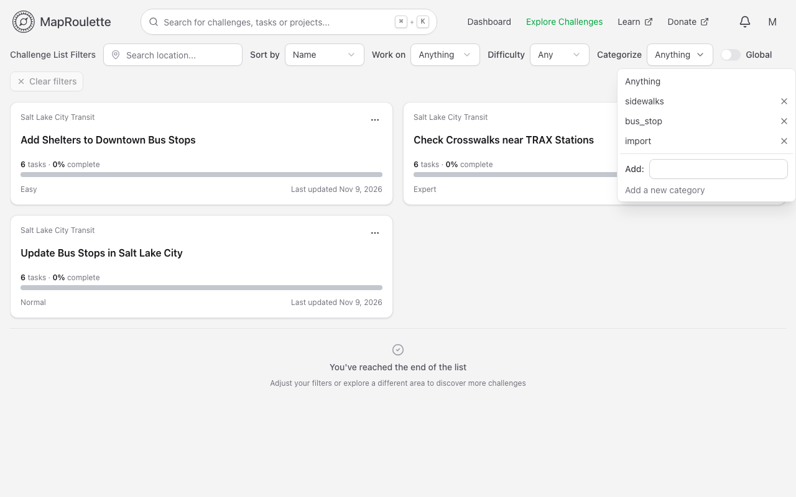{: .only-light}
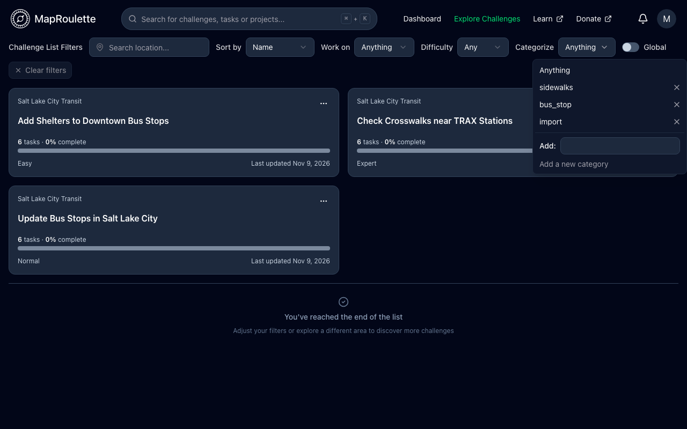{: .only-dark}

The categorization keywords being sorted through are declared in the **Additional Categorization Keywords** field of the challenge creation form.

## By Text or Id

You can type any text you want into the search box at the top to find Challenges, Projects, and Tasks. The search will look at the names of Challenges and Projects, and will search for a task by its Id. You can also open it with <kbd>Ctrl</kbd> <kbd>K</kbd> (<kbd>⌘</kbd> <kbd>K</kbd> on a Mac). See [Searchbox Short Commands](/documentation/searchbox-short-commands/) for more.

## By Location

MapRoulette Challenges cover the entire world. But if you only want to filter for challenges in a particular location, you can use the location search to filter for tasks based on a country, state, city, road, or various other landmarks related to the challenges you are wanting to find.

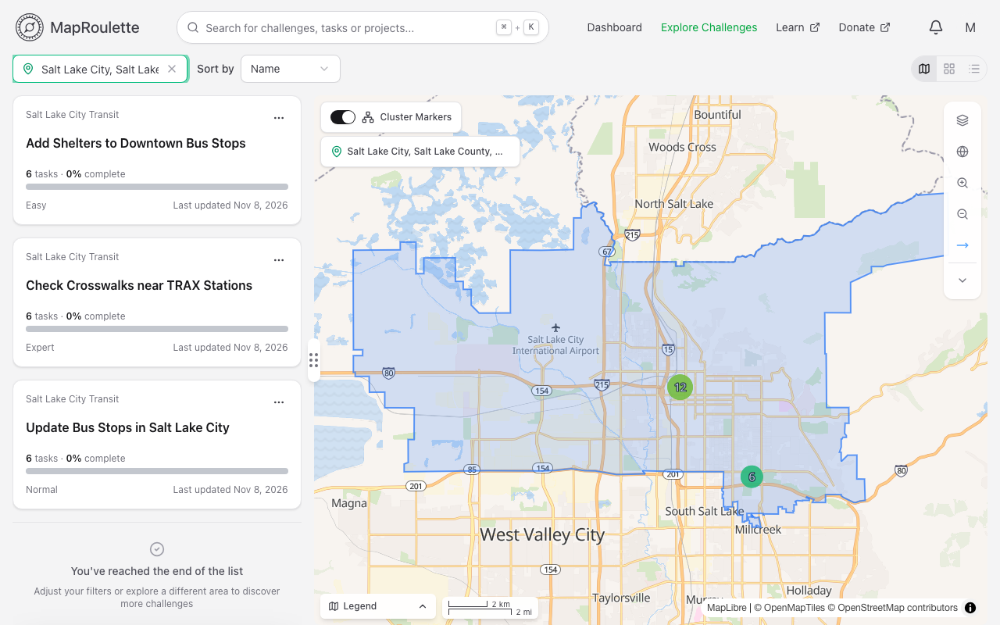{: .only-light}
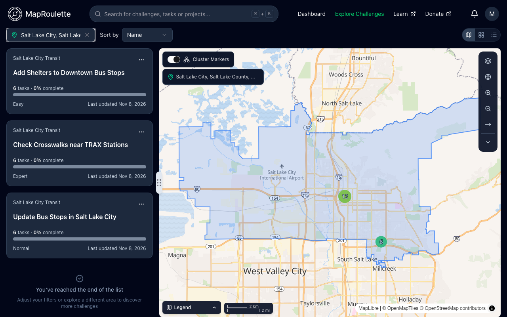{: .only-dark}

Challenges that cover very large areas are marked as global, and are hidden by default. Turn on **Global** to include them.
