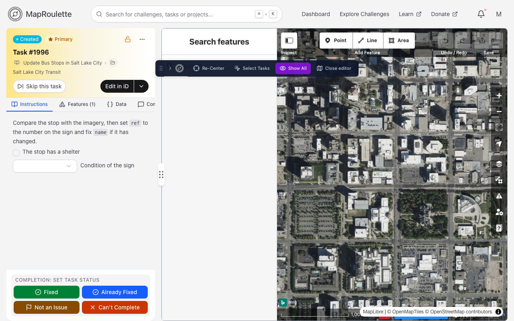
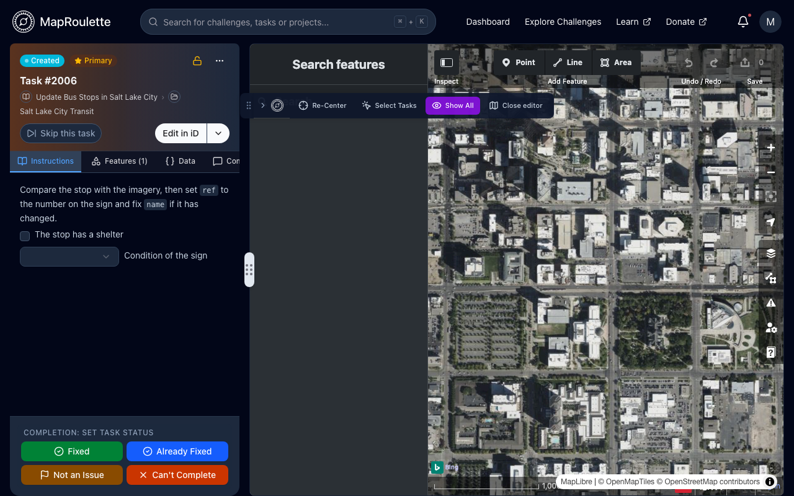
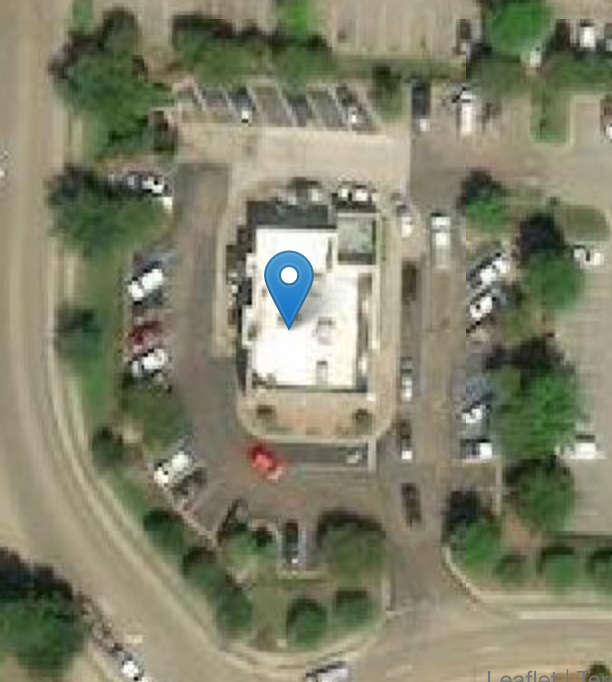

Most tasks can be edited without leaving MapRoulette, so you don't have to
bounce out to a separate application and back.

## The built-in iD editor

Once you've locked a task, choose **Edit in iD** at the top of its map to open
the iD editor inline, in place of the task map. The task's OSM features are
pre-selected for you, and the changeset comment is pre-filled from the
challenge, exactly as it would be if you had opened iD in a new tab.

{: .only-light}
{: .only-dark}

### MapRoulette's controls

A small panel floats over the editor with MapRoulette's own controls. Drag it
by the grip on its left edge to move it anywhere on screen — it starts just
below iD's toolbar, and wherever you put it is remembered for next time. The
chevron beside the grip collapses it down to just the MapRoulette logo.

- **n unsaved changes** — appears once you have edits pending. Click it to see
  exactly what they are: every element created, modified or deleted, with each
  modified element's tags shown against how they looked before you started
- **Re-Center** — reset the view back to the task location
- **Select Tasks** — re-select this task's features in iD, handy after you've
  clicked elsewhere on the map
- **Focus** / **Show All** — hide everything except the task's features, or
  bring the rest of the map back. The editor opens with Focus on. Hidden
  features can't be clicked either, so it's a good way to work on a crowded map
  without selecting a neighbour by accident
- **Close editor** — switch back to the task map. The editor stays loaded in
  the background, so your unsaved edits are kept and are still there when you
  open it again

The task panel on the left also lists your unsaved edits as you work, so you
can see what you're about to submit without opening the editor's own save
dialog.

You still save your work through iD itself, and then set the task status in
MapRoulette as usual.

## Opening an external editor instead

The editor button in the task header opens the task in whichever editor you've
set as your default — **Edit in iD**, **Edit in JOSM**, **Edit in new JOSM
layer**, **Edit just features in JOSM**, **Edit in level0** or **Edit in
Rapid** — in a separate tab or application. The arrow beside it lists the same
editors under **Open this task in:**, each with its keyboard shortcut, and
under **Set Default Editor:** lets you change your default. See [Setting your
default OSM Editor](/documentation/setting-your-default-osm-editor/).

> Earlier versions of MapRoulette embedded the **Rapid** editor in the task
> screen. Rapid is now offered as an external editor only; the embedded editor
> is iD.
{: .legacy}

On [Tag Fix challenges](#tag-fix-tasks) the editor button
opens the built-in iD editor whatever your default is, because MapRoulette
applies the challenge's suggested tags there for you. Picking another editor
from the arrow menu still opens it, but without the suggestion applied.

## Tag Fix tasks

Most MapRoulette tasks ask you to go and fix something yourself. A **Tag Fix**
task is different: the challenge already knows what it thinks the change should
be, and hands it to you ready-made. Your job is to judge whether it's right.

Consider this aerial image of a Wendy's restaurant:

{:width="500"}

You can see from the aerial imagery that this restaurant has a `drive_through`:
cars snake around the structure on a dedicated lane. But the restaurant does not
have `drive_through=yes` in OSM. That is exactly the kind of small, verifiable
change a Tag Fix challenge is built for.

### Working a Tag Fix task

When you lock a Tag Fix task, MapRoulette opens the built-in **iD** editor for
you automatically and applies the challenge's suggested tags there as unsaved
edits. It uses iD whatever editor you normally prefer, because iD is the one
MapRoulette can drive on your behalf.

Nothing is submitted for you. The changes sit in iD exactly as though you had
typed them, so you can:

- look them over on the map, with the affected element already selected
- correct a value the challenge got slightly wrong
- undo one you disagree with
- add something the challenge missed

and then save them as your own edit, through iD, and set the task status as
usual.

### Seeing what changed

The task panel on the left shows the change in two stages.

**Before the editor opens** it lists what the challenge suggests, compared
against the element's current tags in OpenStreetMap — so a suggestion the
element already satisfies is shown as such rather than as a change.

**Once the editor is open** it switches to your unsaved edits: everything
currently pending, whether the challenge suggested it or you did it yourself.
Each modified element's tags are shown against how they looked before you
started.

#### Reset

While a Tag Fix task is open in the editor, the panel offers a **Reset**. It
puts the editor back to exactly the state it was in when the suggestion was
applied, discarding everything you've done since that you haven't saved. That
includes edits to other elements, not just the ones the challenge names, and
any geometry you drew or moved. You're asked to confirm first, and nothing
you've already saved to OpenStreetMap is affected.

The panel tells you which state you're in: either the editor holds the
challenge's suggestion and nothing else, or you have edited since the
suggestion was applied. **Reset** stays disabled until you've changed
something.

### Working several at once

If you [bundle tasks together](/documentation/solving-multiple-tasks-together/),
every bundled Tag Fix task's suggestion is applied. Adding a task to the bundle
applies its suggestion; removing one takes its suggestion back out again,
leaving any editing you did to that element yourself in place.

### Limits

Only tag changes to existing elements are applied for you. A challenge can also
describe creating or deleting elements, and those are deliberately left for you
to do by hand — applying them automatically would be a much larger claim than
"these tags look wrong".

To create one, see [Tag Fix Challenges](/documentation/tag-fix-challenges/).
