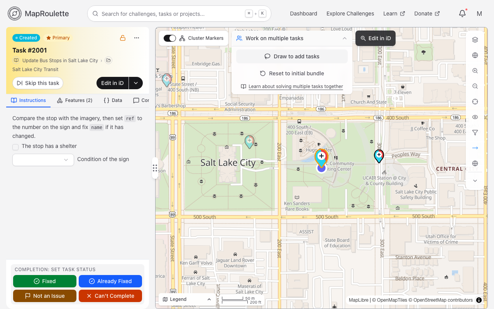
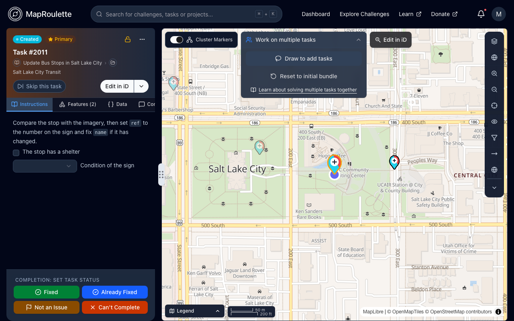
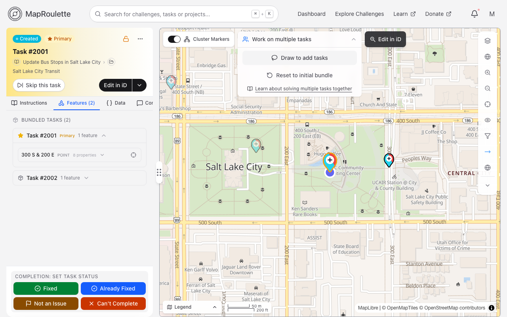
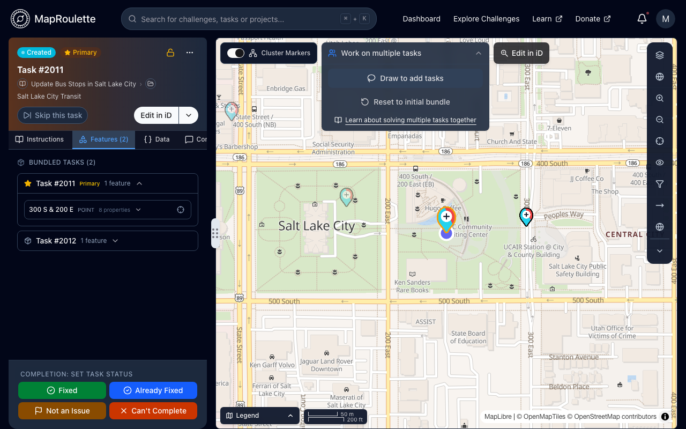

Many MapRoulette Challenges have Tasks that are geographically so close together that it is more efficient to solve multiple close Tasks together as if it were one Task.

To work on multiple tasks, start a task and open the **Work on multiple tasks** panel at the top of the task map. You can select tasks either by clicking **Draw to add tasks** and drawing a shape around them, or by clicking a nearby task marker and choosing **Add to Bundle**. A bundle can hold up to 50 tasks.

{: .only-light}
{: .only-dark}

The selected Tasks are now bundled into one Task, and are listed under **Bundled Tasks** on the **Features** tab. The task you started from is marked **Primary**.

{: .only-light}
{: .only-dark}

Solving this Bundled Task works the same as solving a single Task: the status and comment you set apply to every task in the bundle. If you change your mind, the same panel offers the option to unbundle the Tasks with **Work on only the primary task**, or you can choose **Remove from Bundle** on a single task.

