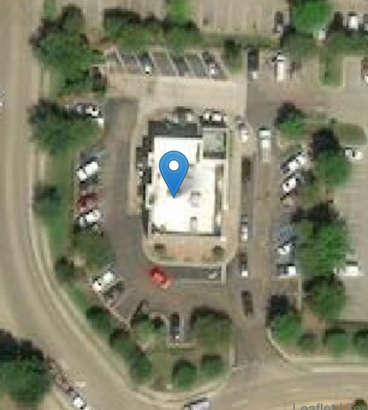

Most MapRoulette tasks ask you to go and fix something yourself. A **Tag Fix**
task is different: the challenge already knows what it thinks the change should
be, and hands it to you ready-made. Your job is to judge whether it's right.

Let’s look at an example. Consider this aerial image of a Wendy’s restaurant:

{:width="500"}


You can see from the aerial imagery that this restaurant has a `drive_through`: you can see cars snaking around the structure on a dedicated lane.

## Working a Tag Fix task

When you lock a Tag Fix task, MapRoulette opens the built-in **iD** editor for
you automatically and applies the challenge's suggested tags there as unsaved
edits. It uses iD whatever editor you normally prefer, because iD is the one
MapRoulette can drive on your behalf.

Nothing is submitted for you. The changes sit in iD exactly as though you had
typed them, so you can:

- look them over on the map, with the affected element already selected
- correct a value the challenge got slightly wrong
- undo one you disagree with
- add something the challenge missed

and then save them as your own edit, through iD, and set the task status as
usual.

## Seeing what changed

The task panel on the left shows the change in two stages.

**Before the editor opens** it lists what the challenge suggests, compared
against the element's current tags in OpenStreetMap — so a suggestion the
element already satisfies is shown as such rather than as a change.

**Once the editor is open** it switches to your unsaved edits: everything
currently pending, whether the challenge suggested it or you did it yourself.
Each modified element's tags are shown against how they looked before you
started.

### Reset

While a Tag Fix task is open in the editor, the panel offers a **Reset**. It
puts the editor back to exactly the state it was in when the suggestion was
applied, discarding everything you've done since that you haven't saved. That
includes edits to other elements, not just the ones the challenge names, and
any geometry you drew or moved. You're asked to confirm first, and nothing
you've already saved to OpenStreetMap is affected.

The panel tells you which state you're in: either the editor holds the
challenge's suggestion and nothing else, or you have edited since the
suggestion was applied. **Reset** stays disabled until you've changed
something.

## Working several at once

If you [bundle tasks together](/documentation/solving-multiple-tasks-together/),
every bundled Tag Fix task's suggestion is applied. Adding a task to the bundle
applies its suggestion; removing one takes its suggestion back out again,
leaving any editing you did to that element yourself in place.

## Limits

Only tag changes to existing elements are applied for you. A challenge can also
describe creating or deleting elements, and those are deliberately left for you
to do by hand — applying them automatically would be a much larger claim than
"these tags look wrong".

## Creating a Tag Fix challenge

The challenge form has no Tag Fix option. A challenge becomes a Tag Fix
challenge when its tasks carry the proposed changes: upload the tasks as
[line-by-line GeoJSON](/documentation/line-by-line-geojson/) and give each
task's `FeatureCollection` a `cooperativeWork` object. In an ordinary
GeoJSON file, a `cooperativeWork` object alongside the file's single
`features` list is ignored, and you get normal tasks instead.

### With mr-cli

The easiest way to build these files is the
[mr-cli](https://www.npmjs.com/package/@maproulette/mr-cli) command-line tool.
See its documentation for details, and
[this post on the MapRoulette blog](https://blog.maproulette.org/2022/11/07/tutorial-tagging-parkingsurface-efficiently-with-a-maproulette-tag-fix-challenge/)
for a complete worked example.

### By hand

Each task's line in the file is a `FeatureCollection` with a
`cooperativeWork` object alongside its `features`:

```javascript
{
  "type": "FeatureCollection",
  "features": [ ... ],            // the task's features, as usual
  "cooperativeWork": {
    "meta": {
      "version": 2,               // must be format version 2
      "type": 1                   // 1 for a tag fix
    },
    "operations": [ ... ]         // see below
  }
}
```

The `features` are used for everything a task's features are normally used
for — drawing the task on the map, locating it, prioritizing and searching it —
but the proposed changes come only from `operations`.

#### Operations

`operations` is a list of `modifyElement` operations, one per OSM element you
want to change. Each names an existing element and lists the changes to make
to its tags:

```javascript
{
  "operationType": "modifyElement",
  "data": {
    "id": "way/12345678",
    "operations": [ ... ]         // setTags and unsetTags, in order
  }
}
```

The `id` must be the element type and number, written as `node/123`,
`way/123` or `relation/123`. An operation with any other form of id is
skipped.

Inside it, two operations change the element's tags:

- **`setTags`** adds tags, or changes the value of tags the element already
  has. `data` is an object of tag names and values. List only the tags you
  want to change, not every tag on the element.

  ```javascript
  { "operation": "setTags", "data": { "name": "Walgreens", "amenity": "pharmacy" } }
  ```

- **`unsetTags`** removes tags. `data` is a list of tag names; a tag the
  element doesn't have is ignored.

  ```javascript
  { "operation": "unsetTags", "data": ["fixme", "note"] }
  ```

#### Full example

One task's line, shown over several lines for readability, proposing a new
`building` tag and the removal of `fixme` on a single way:

```javascript
{
  "type": "FeatureCollection",
  "features": [
    {
      "type": "Feature",
      "properties": { "@id": "way/12345678" },
      "geometry": {
        "type": "Point",
        "coordinates": [13.4050, 52.5200]
      }
    }
  ],
  "cooperativeWork": {
    "meta": { "version": 2, "type": 1 },
    "operations": [
      {
        "operationType": "modifyElement",
        "data": {
          "id": "way/12345678",
          "operations": [
            { "operation": "setTags", "data": { "building": "yes" } },
            { "operation": "unsetTags", "data": ["fixme"] }
          ]
        }
      }
    ]
  }
}
```

> Earlier versions of MapRoulette also supported a second kind of cooperative
> challenge, whose tasks carried an OSMChange (`.osc`) file to be loaded into
> the mapper's editor (`"type": 2`). The current interface does not load those
> files, so only tag fixes work.
{: .legacy}
