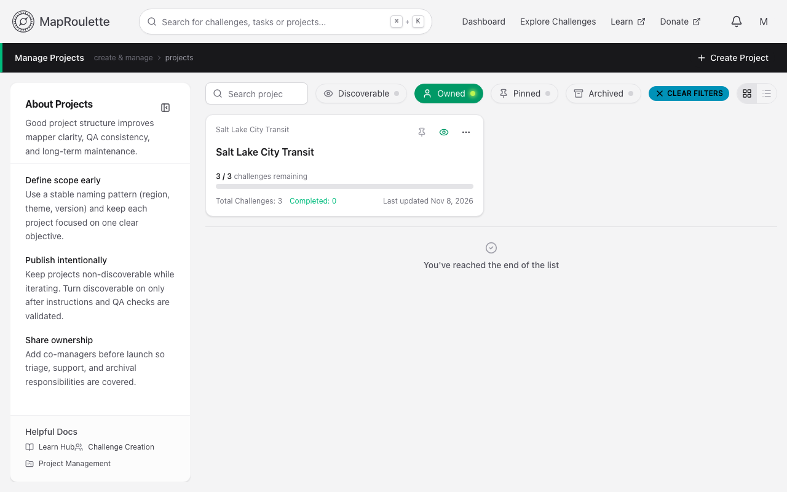
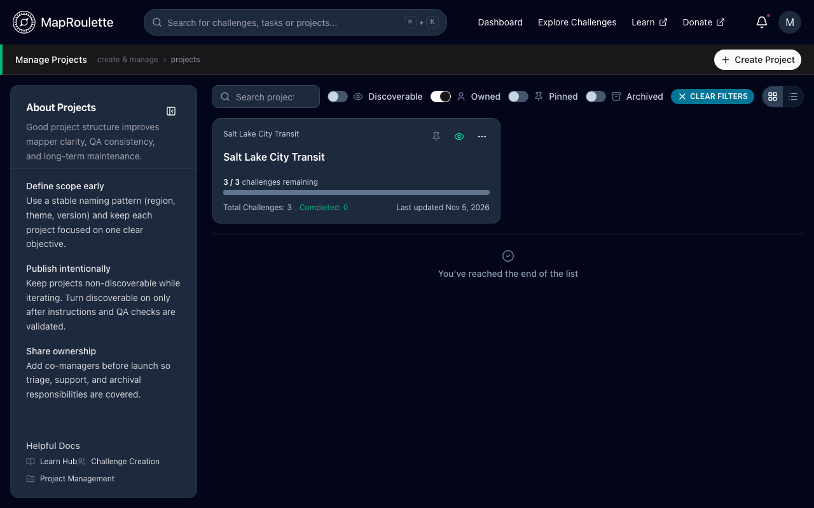

Projects are how challenges are organised: every challenge belongs to exactly
one project, and permissions on the project decide who can manage the
challenges inside it.

## Managing your projects

{: .only-light}
{: .only-dark}

**Manage → Projects** (from the user menu) lists the projects you manage. From
there you can:

- **Create Project** — a new project needs a **Project Name** (a unique
  identifier, lowercase with no spaces) and a **Display Name** shown to users,
  and takes an optional description. Under **Visibility**, the **Enabled**
  switch makes it discoverable (super admins also get a **Featured** switch),
  and an optional **Team** section picks a team to own it (see [Teams that own
  a project](#teams-that-own-a-project))
- open a project to see its challenges, its statistics, and its **Project
  Playbook** of setup advice
- **Add challenge** inside it
- **Pin project**, or make it discoverable or not with the eye button on its
  card (**Make discoverable** / **Make not discoverable**; see [Challenge
  Visibility and
  Discovery](/documentation/challenge-visibility-and-discovery/))
- **Edit project**, **Export CSV** of its tasks, **Archive project**, or
  **Delete project** from its menu

On the project's own page the same visibility setting is the **Enable
project** / **Disable project** button.

Deleting a project marks it, along with all of its challenges and their tasks,
for deletion, and MapRoulette removes it permanently some time later. There's
no way to undo this from MapRoulette.

A challenge can be moved between projects you manage with **Move challenge** in
the challenge's menu on its project's page.

{: .only-light}
{: .only-dark}

## Project roles

Project permissions are granted per user with one of three roles. A team brings
its own roles instead — see [Attaching a team](#attaching-a-team):

**Read** — view the project overview page and the challenges under the project.

**Write** — create and edit challenges in the project, and edit the project's
details.

**Admin** — everything Write can do, plus making the project discoverable or
not, changing the team that owns it, deleting it, and adding and removing
other managers and changing their roles.

A project always needs at least one Admin. MapRoulette won't remove the last
user holding the Admin role, or change their role to Write or Read; give
someone else Admin first. Teams don't count towards this. Removing a manager
who isn't an Admin is never blocked.

### Adding and removing managers

**Managers and teams**, in the project's actions, lists everyone with a role on
the project and every team attached to it. From there you can:

- search for a mapper by their OpenStreetMap username, pick the role to give
  them, and add them
- change an existing manager's role from the dropdown beside their name
- search for a [team](/documentation/teams/) by name and attach it
- remove a manager, or detach a team, with the bin icon

### Attaching a team

Attaching a team is usually easier than adding people one at a time, and it
keeps up with the team as its membership changes.

There is no role to pick for a team, because a team already has roles of its
own. What each person can do on the project follows the role they hold **in the
team**:

| Their role in the team | What they get on the project |
| --- | --- |
| Owner | Admin |
| Admin | Admin |
| Manager | Write |
| Member | nothing |

Belonging to a team is not the same as running its work, so plain members get
no access to a project their team is attached to.

A grantee who somehow holds more than one role is shown as the strongest of
them.

### Teams that own a project

Attaching a team is different from giving a project **to** a team. A project can
have one owning team, chosen in the project form, and that team's image becomes
the picture on the project's card. Ownership is about whose project it is;
attachment is about who is helping run it. Both give access by the same rule
above.

## Tips

- **Define scope early.** Use a stable naming pattern (region, theme, version)
  and keep each project focused on one clear objective.
- **Publish intentionally.** Keep projects non-discoverable while iterating;
  turn discoverable on only after instructions and QA checks are validated.
- **Share ownership.** Arrange co-managers before launch so triage, support and
  archival responsibilities are covered.
