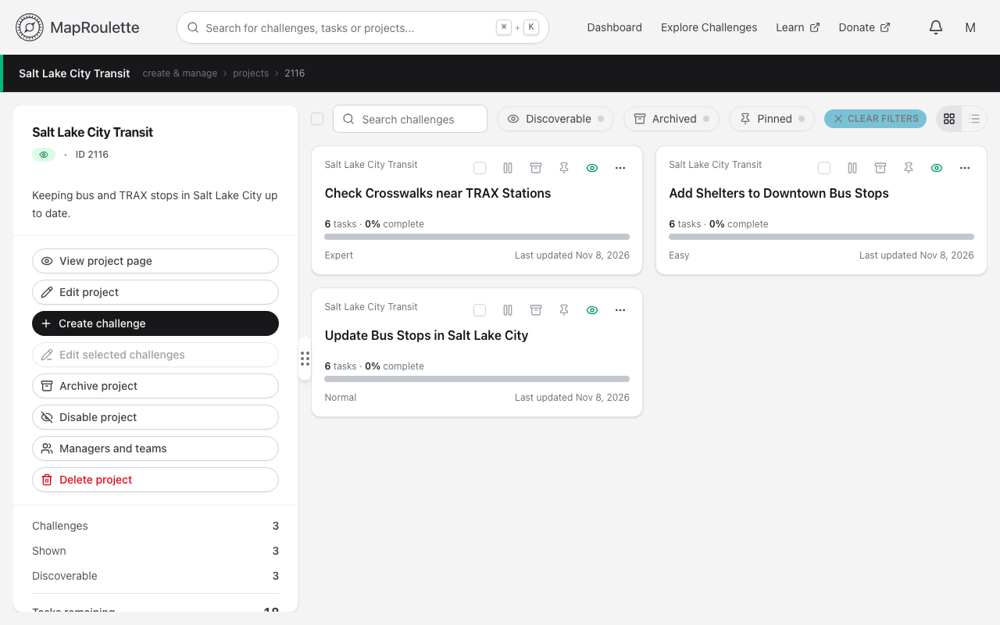
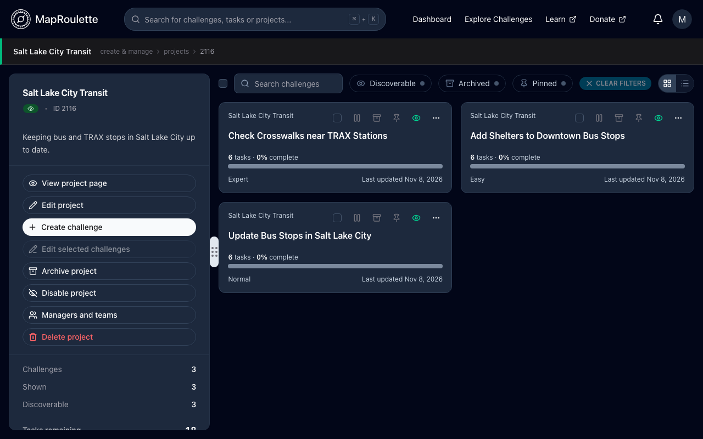
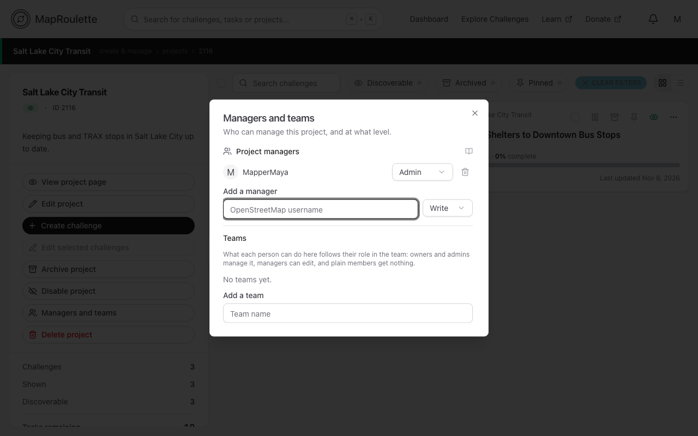
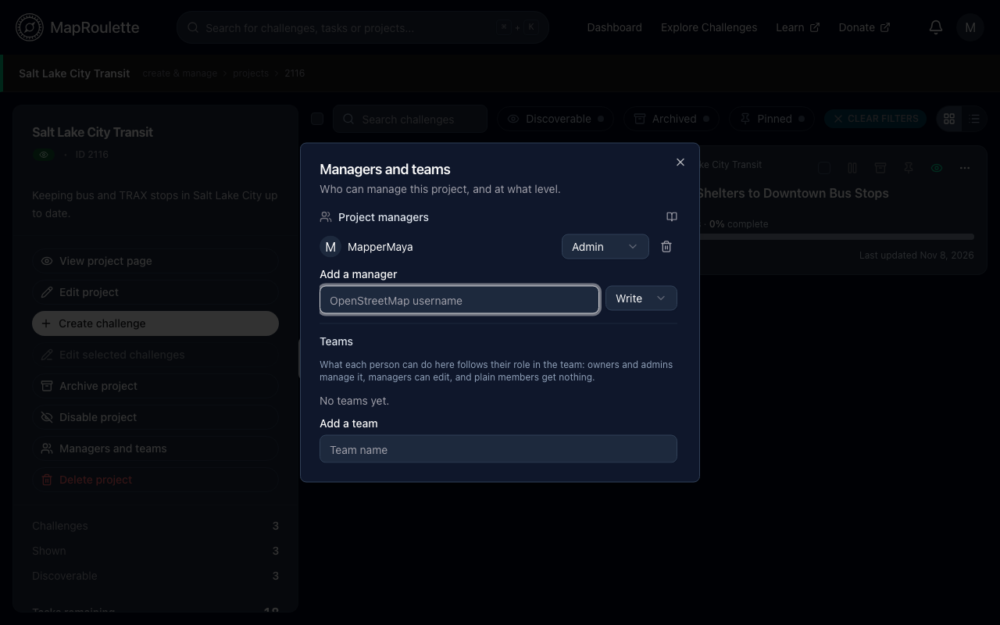

MapRoulette provides lots of project and team tooling for users to collaborate. One feature that assists with this is the **Managers and teams** dialog in the Project overview page. Every challenge belongs to a project, and you can find the projects you manage under **Manage → Projects** in the user menu.

{: .only-light}
{: .only-dark}

Here, the creator of a project can designate other users or teams to manage the project or even take a project over.

## Adding a user or team

Simply use the search box to find a user by their OpenStreetMap username. You can also assign a team. More about teams [here](/documentation/teams/)

{: .only-light}
{: .only-dark}

## Assigning a user privileges

Users can be assigned various roles in the project

**Read** - A user will be able to view the project overview page and the challenges under the project
**Write** - A user will be able to create and edit challenges in the project, and edit the project's details
**Admin** - A user will have complete access to managing, editing, or deleting a project. Users will also be able to remove other managers or change their privileges.

A team doesn't get a role of its own. Its owners and admins get Admin on the project, its managers get Write, and its plain members get no access.

## Removing a user or team

An Admin has the ability to remove a user or team from the project.

## Removing an admin

A project always requires at least one admin, so once another user is assigned **Admin**, other admins will be able to be demoted.
