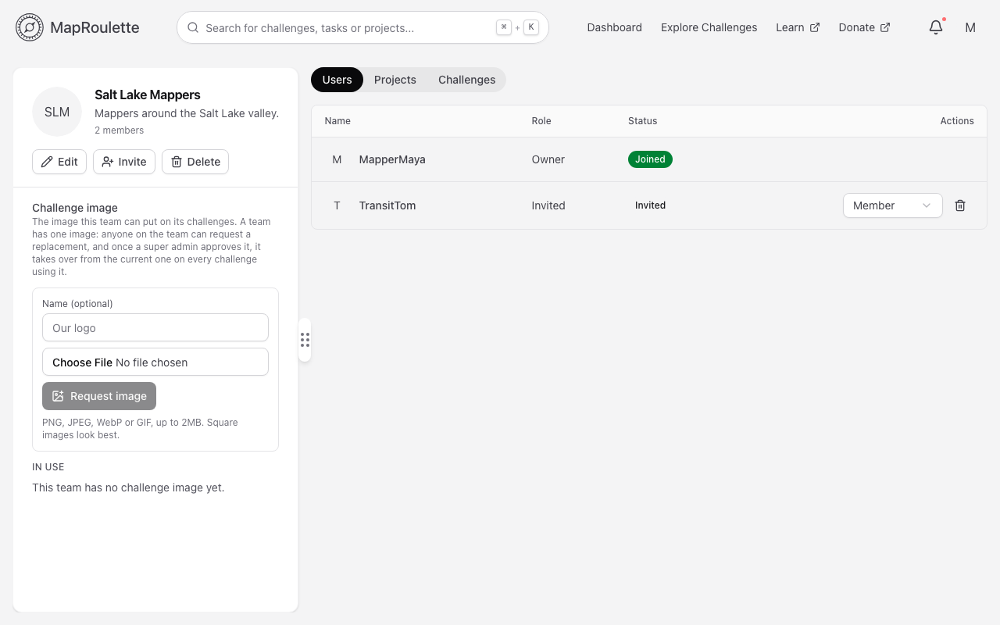
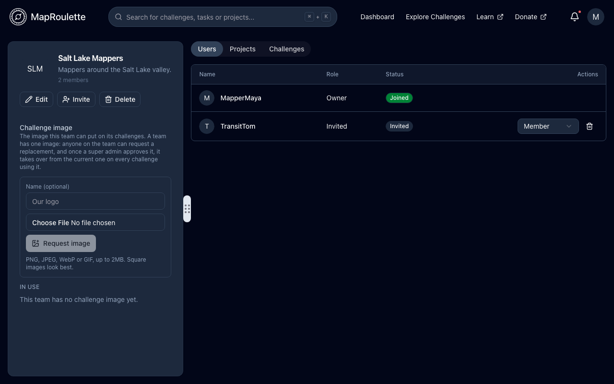

MapRoulette offers Teams that make it possible to group together affiliated users, such as users in a local a mapping club or attendees at a mapathon. Anyone can start a new team and invite other users to join their team.

The primary purpose of teams is to make it easier to grant project permissions to groups of users. When a Team is added to a project, its members get access to that project for as long as they are members of the team.

### Starting a New Team

To start a team, go to the [Dashboard](/documentation/your-dashboard/) and use the **+** control in the Teams section. Once you've provided a team name and description, and saved your new team, you can click on it and start inviting users to join your team.

{: .only-light}
{: .only-dark}

> Note: Teams and their membership are public. Private teams are not supported.

### Team Roles

Members of teams have roles on the team itself: Owner, Admin, Manager, or Member. Owners have full control of the team, including deleting it. Admins can invite and remove members, change their roles (only owners can make someone an Owner), and edit the team name and description. Managers can manage the projects and challenges the team is responsible for. Members belong to the team but have no management capability.

> Note that a team member's role also decides what they can do on a project the team is added to: owners and admins get Admin, managers get Write, and plain members get no access.

Teams must have at least one Owner. If you wish to leave a team you created, you will first need to grant another team member the Owner role if you haven't already.

### Adding a Team to a Project

**Managers and teams** on a project's page lets you add Teams to projects. You do not have to be a member of a Team to add it to your project. See [Projects and Project Managers](/documentation/projects-and-project-managers/).

> :warning: When you add a Team to a project, you are conferring project permissions to every Owner, Admin and Manager of the Team, including any who are added later.

Projects must have at least one user with an Admin role. A Team cannot be the sole administrator of a project.

A project or challenge can also be owned by a team, chosen in the project or challenge form. The team's image is then shown on its card. Anyone on the team can request an image from the team's page, and it appears once a super admin approves it.

### Accepting or Declining an Invitation

Have you been invited to a join a team? Your pending invitations appear in the Teams section of your Dashboard, with options for accepting or declining the invitation.

