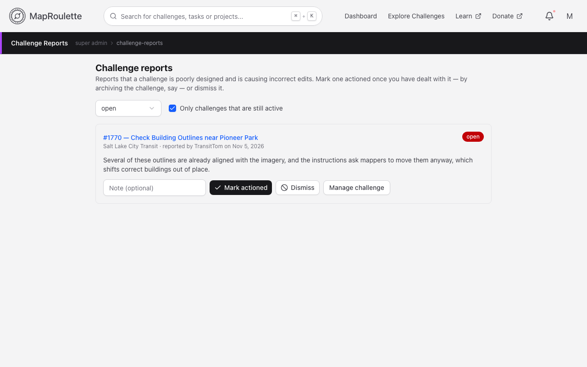
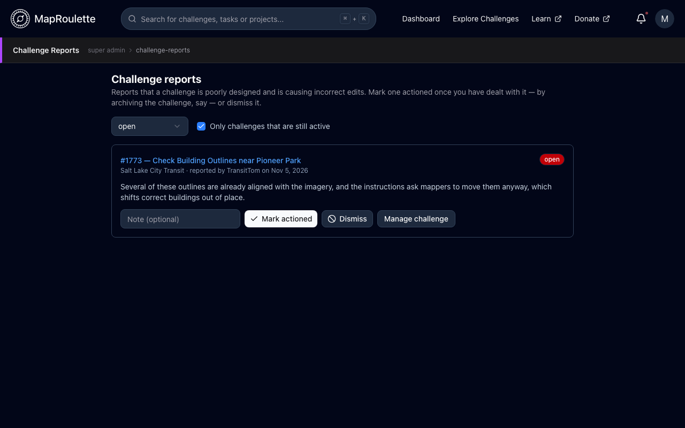

Super users get a **Super Admin** entry in the user menu, with tools that apply to the whole installation rather than a single project or challenge.

Super user status is granted on the server, either by adding the account's OSM id to the backend's `MR_SUPER_ACCOUNTS` setting and restarting the backend (the account must have signed in at least once), or by an existing super user calling `PUT /api/v2/superuser/:userId` with the account's MapRoulette user id.

{: .only-light}
{: .only-dark}

## User Management

Lists every account on the installation with its role and join date.

## Challenge Reports

The queue of [challenge reports](/documentation/challenge-flagging/) filed by mappers. Each report can be marked **actioned** if something was done about it, or **dismissed**, with an optional note.

## Team Challenge Images

Images that teams have requested for their challenges must be approved here before they're shown. See [Teams](/documentation/teams/).
