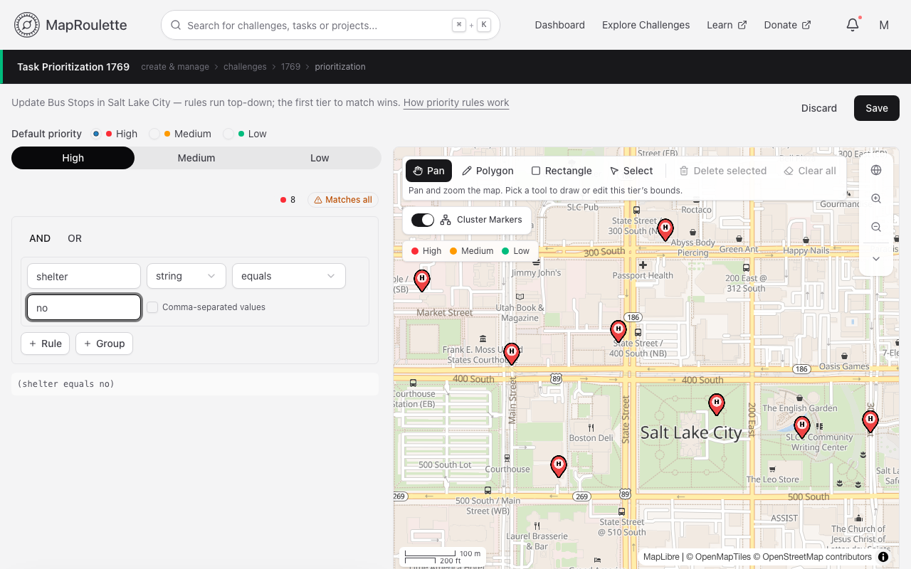
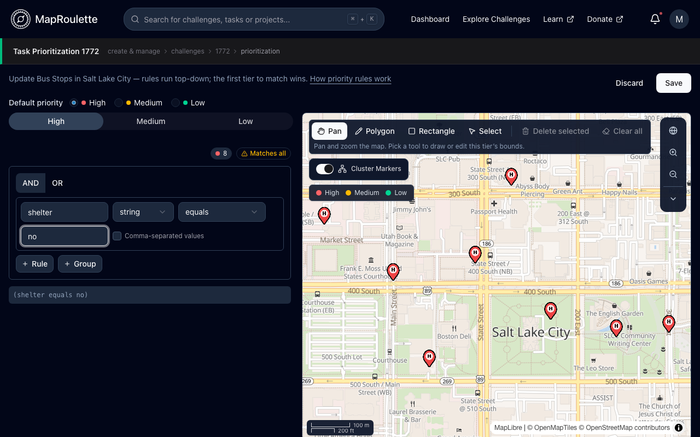

Tasks within a challenge can be prioritized by challenge managers as high, medium, or low priority. Available higher priority tasks will generally be served to mappers ahead of lower priority tasks. (See below for details about how rules are applied.)

Tasks are prioritized using priority rules that match against either task feature properties (such as OSM tags) or their geographic location. The rules are setup by choosing **Configure prioritization** on the challenge's management page, where a preview map colours the challenge's tasks by the priority they would receive. Updated rules are immediately reapplied when they are saved.

{: .only-light}
{: .only-dark}

In addition, MapRoulette offers an editable "default" priority that will be applied to *any task that does not explicitly match any priority rule group*. That is, tasks that match neither the configured high, medium, nor low priority rule groups will receive the default priority. If no priority rules are setup, then all tasks will receive the default priority.

Each property-based priority rule is setup with a data type, the name of the property to check, a comparison operator, and a desired property value. For example, a rule setup using `building` `string` `equals` `yes` would match tasks with a `building` tag set to `yes`. The available comparison operators will change depending on the type. For example, an `integer` type will have numeric operators like `greater than` and `less than` whereas a `string` type will have textual operators like `equals` and `contains`.

It is important that the data type on the rule is set correctly for the type of data found on the property.

| Choose    | For                                    |
|:----------|:---------------------------------------|
| String    | Text                                   |
| Integer   | Whole numbers                          |
| Double    | Decimal numbers                        |
| Long      | Really big whole numbers (> 4 billion) |

Multiple rules can be setup as a group for a given priority. Those rules are then either ANDed together (*all* rules in the group must positively match a task's properties for the task to be considered a match) or ORed together (*any* rule in the group must positively match a task's properties for the task to be considered a match). Furthermore, rules can be nested for greater granularity by adding a group inside a group.

> Note that if a task matches multiple priority groups, it will be assigned the *highest* matching priority. For example, if it matches both the high-priority and medium-priority rules, it will be assigned high priority

#### Matching Multiple Tag Values
If you want to match a single tag against multiple possible values (such as `highway` equal to either `trunk` or `primary`), setup a separate rule for each value and then OR them together. Comma-separated values are not split, so `highway` `string` `equals` `trunk,primary` only matches a tag that is literally `trunk,primary`.

#### Location Rules
MapRoulette also supports location rules, whereby a task can be prioritized based on whether it falls inside an area. Use the draw control on the preview map to draw a rectangle or polygon on the tier's tab. A task inside a tier's area matches that tier even if it doesn't match the tier's property rules.

#### How Rules Are Applied
In general, higher priority tasks will be served to mappers ahead of lower priority tasks. So, until there are no high priority tasks left, mappers working on this challenge will only be served high priority tasks. Then, until there are no medium priority tasks left, mappers will only be served medium priority tasks. Finally, mappers will be served the low priority tasks, until the Challenge's tasks are exhausted.

Please note that tasks that are marked "Can't Complete" with higher priority will still be served before any lower priority tasks. The underlying assumption is that a more experienced mapper will still be able to resolve a task that is marked by someone else as "Can't Complete". A [feature request](https://github.com/osmlab/maproulette3/issues/217) proposes letting the Challenge author set the number of times a task that is marked "Can't Complete" is recycled.

