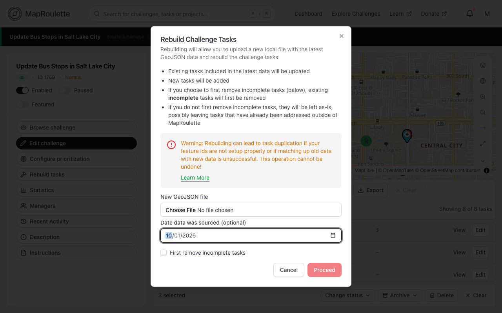
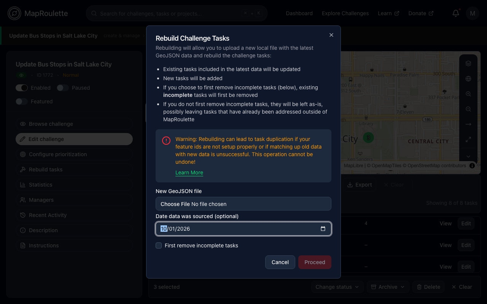

When you rebuild a challenge's tasks, you can record the date on which the
source data was sourced, so the challenge carries a record of how old its
original data is. The date is stored on the challenge (as `dataOriginDate`);
MapRoulette doesn't currently display it to mappers.

The field is **Date data was sourced (optional)** and appears in the dialog
when you [rebuild a challenge's tasks](/documentation/rebuilding-challenge-tasks/)
from a new GeoJSON file you upload, so the date keeps up with the data. It
isn't shown for challenges whose tasks come from an Overpass query or a remote
GeoJSON URL, and the challenge create and edit forms don't have a sourced-date
field.

{: .only-light}
{: .only-dark}
