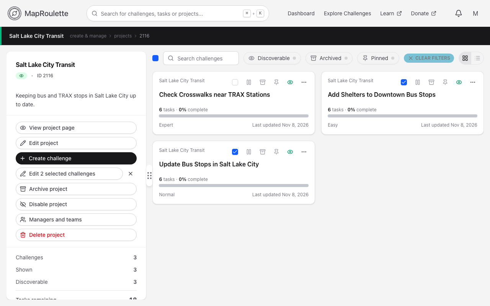
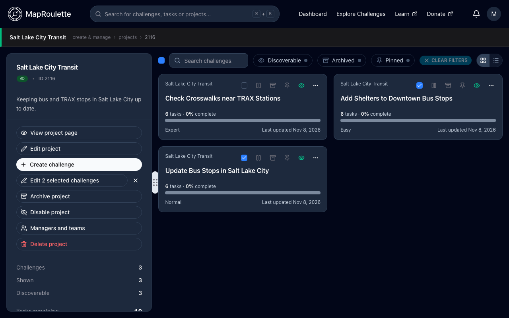
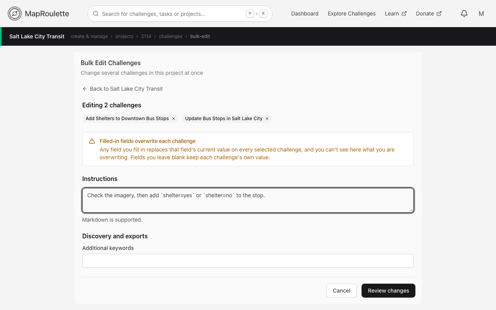
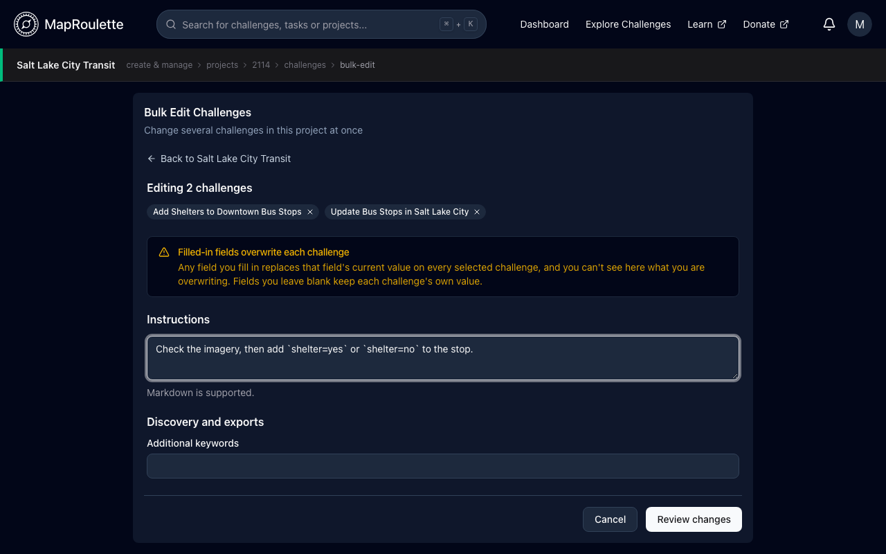
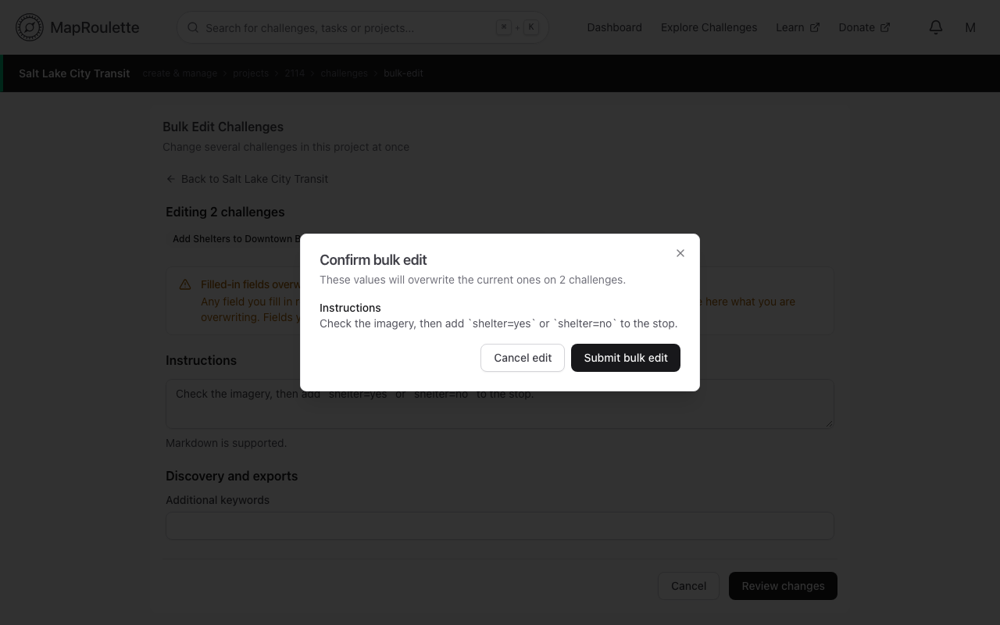
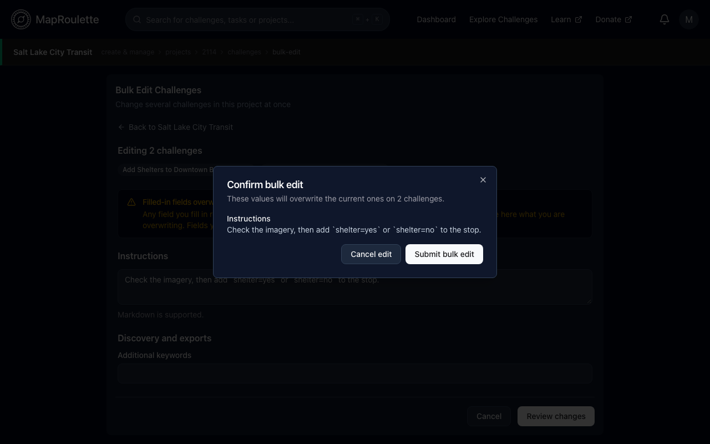

Project owners can **Bulk-edit** challenges within the same project. While this feature isn't as robust as editing a single challenge individually, there are a few fields that allow you to edit multiple challenges for quality of life purposes.

**Keep in mind that this feature, for most fields, will overwrite the original data of each challenge if you choose to utilize the field. Since each challenge can have different data, you will not have context on this page of what you are overwriting.  Use at your own risk.  Fields that you leave alone will leave the original data the way it is.**

## Go to your Project's admin page and select challenges

Simply go to a project's Manage page. In the challenges list, tick the checkbox next to each challenge you would like to edit simultaneously.

{: .only-light}
{: .only-dark}

You can also choose to "select-all" by ticking the checkbox at the top of the list.

## Bulk Edit Page

Next, click **Edit N selected challenges** in the side panel, under **Create challenge**. It stays greyed out until you've selected at least one challenge.

You'll be directed to the bulk edit page.

{: .only-light}
{: .only-dark}

## Remove a challenge from Bulk Edit

You should see a list of the challenges you will be editing simultaneously. If you change your mind on any of the challenges, but don't want to go back and re-select them, you can click the "X" symbol to the right of the challenge name.

## Fields you can bulk edit

- **Instructions**
- **Additional keywords** — each challenge keeps its own category
- **Exportable properties** — the task properties included in CSV and GeoJSON exports
- **Basemap**
- **Data origin date**
- **Priorities** — replaces the default priority and all three [priority rules](/documentation/task-priority-rules/). Each challenge's location bounds are kept.

## Bulk Editing Guidelines

1. Any fields you choose to use for bulk editing will be used to **overwrite** the data that is on each challenge.

2. Any fields you leave alone on the bulk edit page will not do anything to the existing challenge data.

## Submitting A Bulk Edit

Once you've proposed all of the changes you need on the form, press **Review changes** and you will be presented with a confirmation modal that indicates all of the changes that will be made on each challenge.

{: .only-light}
{: .only-dark}

**Cancel edit** will allow you to go back to the form and make any additional changes you like.  Additionally you can choose to abandon all edits by clicking **Cancel** on the bulk edit page.

**Submit bulk edit** will proceed with the submission of edits on each challenge. Challenges are saved one at a time; if one can't be saved, it may be partly changed, the rest are left unchanged, and you're told which ones were saved.

## Bulk task actions

Challenge managers can also change many tasks of a challenge at once from the challenge's task table.

### Select tasks

Go to your challenge's Manage page. The task table lists the tasks inside the current view of the map above it, so pan and zoom the map to cover the area you want, and narrow the list with the Status, Priority and property filters. Then tick the tasks you want to change, or use the checkbox in the header to select all of them.

{: .only-light}
{: .only-dark}

> The table loads tasks in batches as you scroll, so the header checkbox only selects the tasks that have loaded so far. Narrow with the filters first if you want to be sure of what you're acting on.

### Apply an action

With tasks selected, a toolbar lets you:

- **Change status** of every selected task
- **Archive** or **Unarchive** them
- **Delete** them

**Delete cannot be undone.** You'll be asked to confirm first.

{: .only-light}
{: .only-dark}
