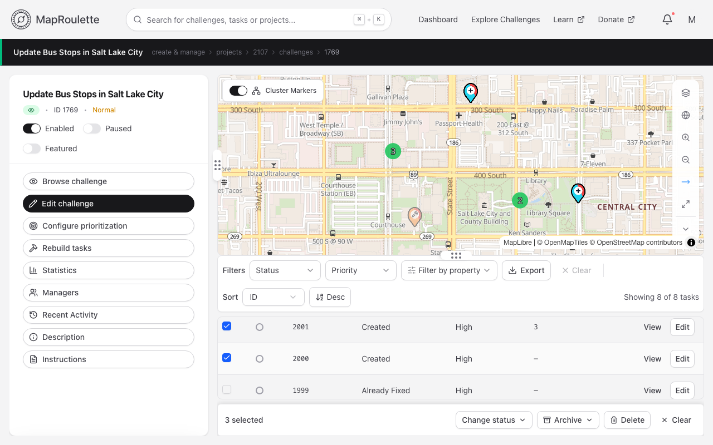
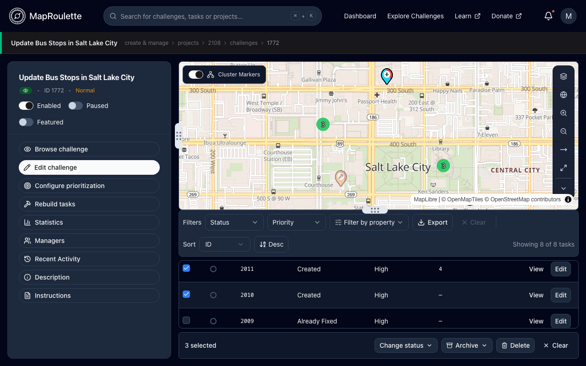
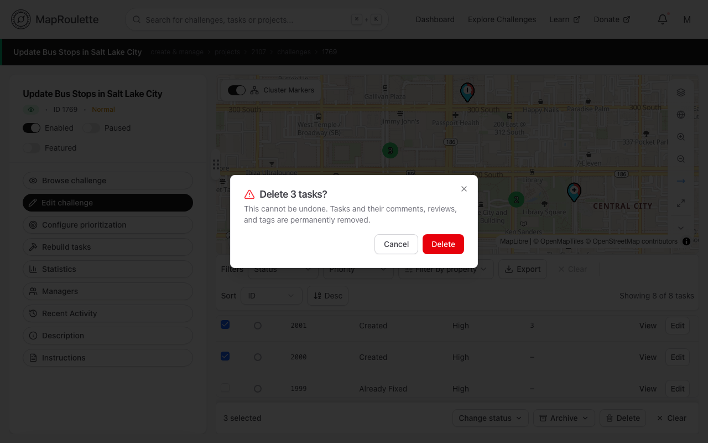
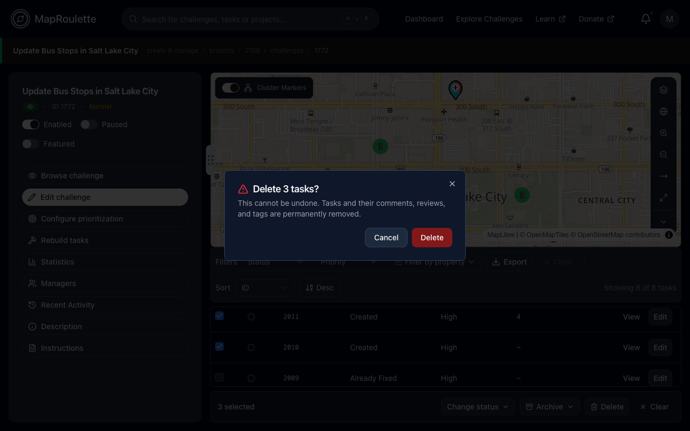

When you're managing a challenge, most changes you need to make across many
tasks at once can be made from the challenge's task table rather than one task
at a time.

## Selecting tasks

Open **Manage** for your challenge to reach the tasks explorer. The table
lists only the tasks inside the current view of the map above it, so pan and
zoom the map to cover the area you want. Narrow the table further with the
**Status**, **Priority** and **Filter by property** filters and the sort
control, then use the checkbox on each row —
or the checkbox in the header, which selects every task loaded into the table
so far — to build a selection. A toolbar appears showing **_n_ selected**.

> The table loads tasks in batches of 50 as you scroll, and the header checkbox
> only selects the rows that have loaded so far, not every task in the
> challenge. Narrow with the filters first if you want to be sure of what
> you're acting on.

{: .only-light}
{: .only-dark}

## Available actions

| Action            | What it does |
| ----------------- | ------------ |
| **Change status** | Choose **Pick a status…**, then pick a status (Created, Fixed, Not an Issue, Skipped, Deleted, Already Fixed, Can't Complete, Answered, Validated, Disabled) and **Apply** to set it on every selected task |
| **Archive** | Pick **Archive** or **Unarchive** from its menu to archive the selected tasks, or bring them back |
| **Delete**        | Permanently removes the tasks along with their comments, reviews and tags |
| **Clear**         | Clears the selection without changing any tasks |

**Archive** and **Unarchive** run as soon as you pick them, with no
confirmation. After a status change or archive, the confirmation message
reports the number of tasks you had selected. **Delete** asks you to confirm
first, then reports how many tasks it actually deleted and how many it
couldn't — a delete can partially succeed if you lack permission on some of the
selected tasks.

**Delete cannot be undone.**

{: .only-light}
{: .only-dark}

## Changing several challenges at once

Editing a batch of challenges through a single form is not part of the current
frontend. Instead, each challenge row — on **Manage → Challenges** and on a
project's page — has icon buttons to pause/resume, archive/unarchive, pin, and
make discoverable, followed by an actions menu with the other per-challenge
operations:

- on **Manage → Challenges**: start, edit, archive/unarchive,
  [rebuild tasks](/documentation/rebuilding-challenge-tasks/), copy URL, and
  delete
- on a project's page: start, edit, move, clone, archive/unarchive,
  [rebuild tasks](/documentation/rebuilding-challenge-tasks/), enable or
  disable, and delete
