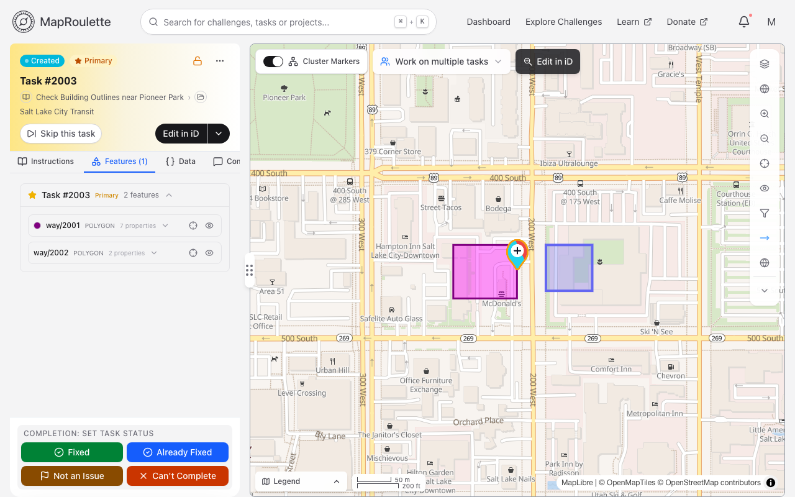
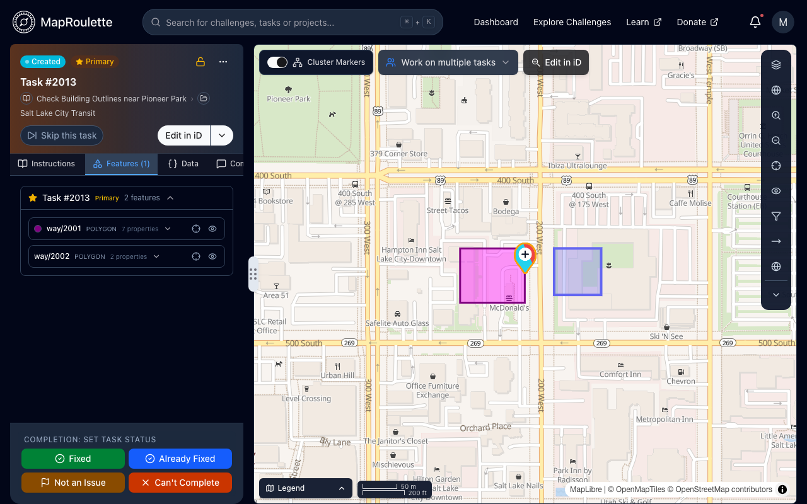

A subset of the [simplestyle](https://github.com/mapbox/simplestyle-spec/blob/master/1.1.0/README.md) specification can be used to customize the appearance of features within a Task by including special feature properties in your task's GeoJSON.

## Styling tasks directly with GeoJSON properties

To style tasks via GeoJSON, simply include the simplestyle properties directly on your feature. This provides you with complete flexibility in determining which tasks are to be styled, and how.

The following simplestyle properties can be used on task features:

| Property         | Description                     | Supported Geometries
|:-----------------|:--------------------------------|:-----------------------------------
| stroke           | Outline color                   | LineStrings, Polygons
| stroke-width     | Thickness of outline            | LineStrings, Polygons
| stroke-opacity   | Translucency of outline         | LineStrings, Polygons
| fill             | Fill color (inside the outline) | Polygons
| fill-opacity     | Translucency of the fill        | Polygons
| marker-color     | Map marker color                | Points

Some notes and caveats:
* colors need to be expressed as [web hex colors](https://en.wikipedia.org/wiki/Web_colors) or (slightly riskier) [common web color names](https://en.wikipedia.org/wiki/Web_colors#X11_color_names)
* opacities need to be decimal numbers between 0.0 (transparent) and 1.0 (opaque)
* stroke-width must be between 0.5 and 40
* fill colors can obscure OSM labels, so be careful about high fill-opacity values
* use of colors used by OSM or MapRoulette to convey special meaning could confuse your mappers

### Example

The following set of properties results in a Way being rendered with a purple stroke (outline) and 50%-opaque fuschia fill, as shown below:

```json
"properties": {
  "@id": "way/258145134",
  "amenity": "community_centre",
  "building": "yes",
  "stroke": "#800080",
  "fill": "#FF00FF",
  "fill-opacity": "0.5"
}
```

{: .only-light}
{: .only-dark}

## Video

HOT has produced [a video](https://youtu.be/gj8MRgiIV-I?t=849) that goes into styling features in MapRoulette. It shows an earlier version of MapRoulette, so some of the screens look different. Check it out!
