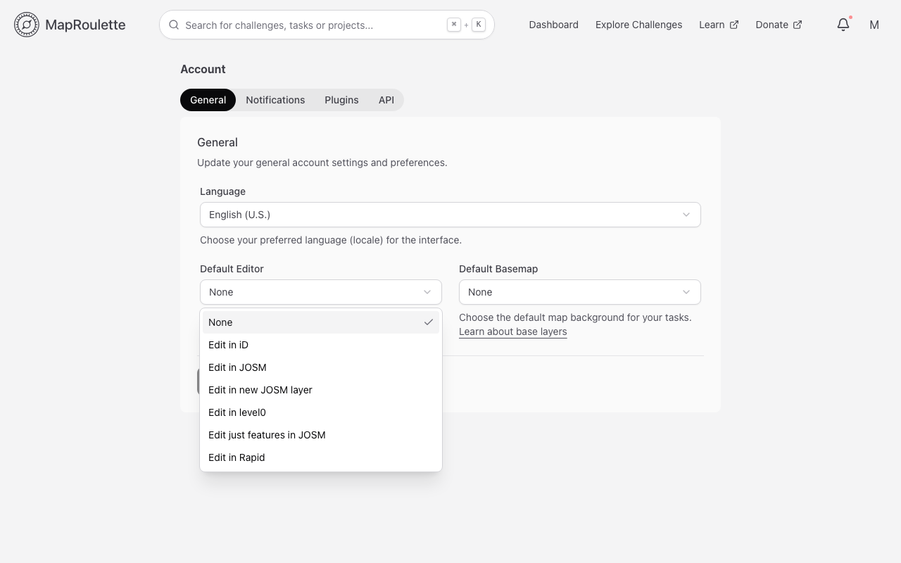
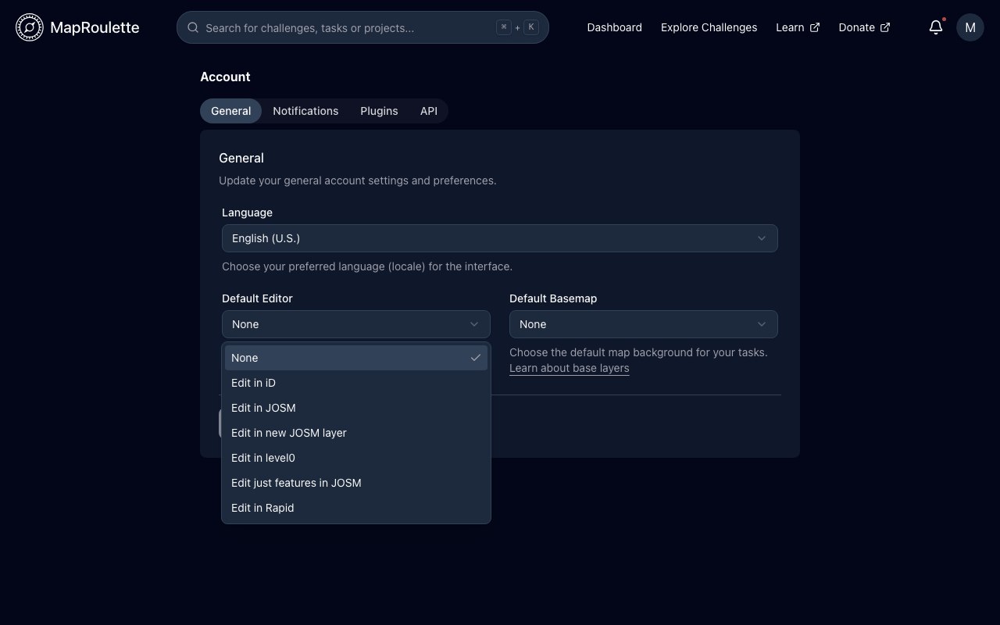
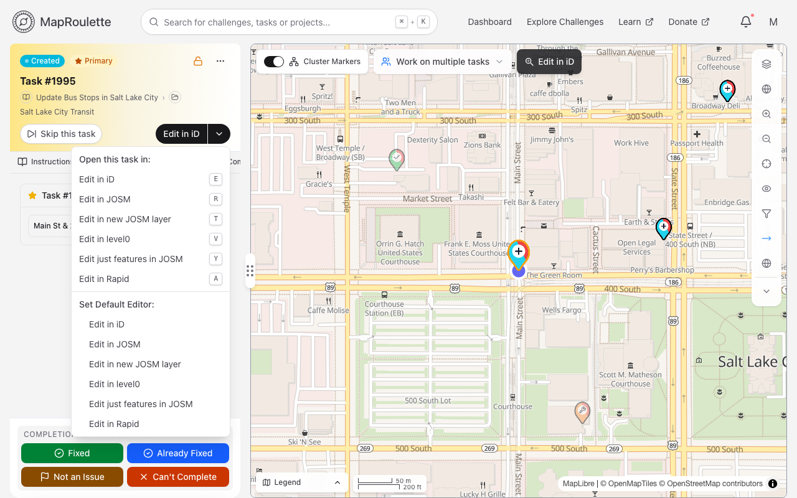
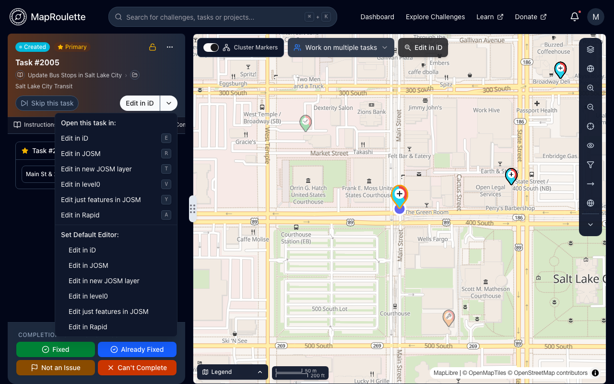

When you open a Task in an editor, you are sent to an OSM Editor to edit OSM
and resolve the task. Everyone has their own preference of OSM Editor, and you
can set this preference from your account settings: open the user menu at the
top right and choose **Account Settings**, then set **Default Editor** on the
**General** tab.

The available options are:

- None
- Edit in iD
- Edit in JOSM
- Edit in new JOSM layer
- Edit in level0
- Edit just features in JOSM
- Edit in Rapid

Notice that for JOSM, you have three different options. You can load the data
within the Task bounding box in the currently active data layer, or in a new
data layer every time. Alternatively, you can load only the relevant OSM
features, instead of all data in the bounding box. For any of the JOSM options,
JOSM has to be running with
[remote control](https://josm.openstreetmap.de/wiki/Help/Preferences/RemoteControl)
enabled.

> The settings form is saved with the **Save Changes** button at the bottom of
> the tab — your changes are not applied until you save them.

{: .only-light}
{: .only-dark}

Because many mappers use different editors based on the task at hand,
MapRoulette also lets you switch editors from the Task screen. The editor
button in the task actions opens your default editor directly. The arrow beside
it opens a menu with two lists:

- **Open this task in:** opens the task in that editor just this once, without
  changing your default. Each editor's keyboard shortcut is shown beside it.
- **Set Default Editor:** saves that editor as your new default, without
  opening anything. A checkmark marks the current default.

{: .only-light}
{: .only-dark}

Some tasks can also be edited without leaving MapRoulette at all — see
[Editing inside MapRoulette](/documentation/rapid-editor/).
