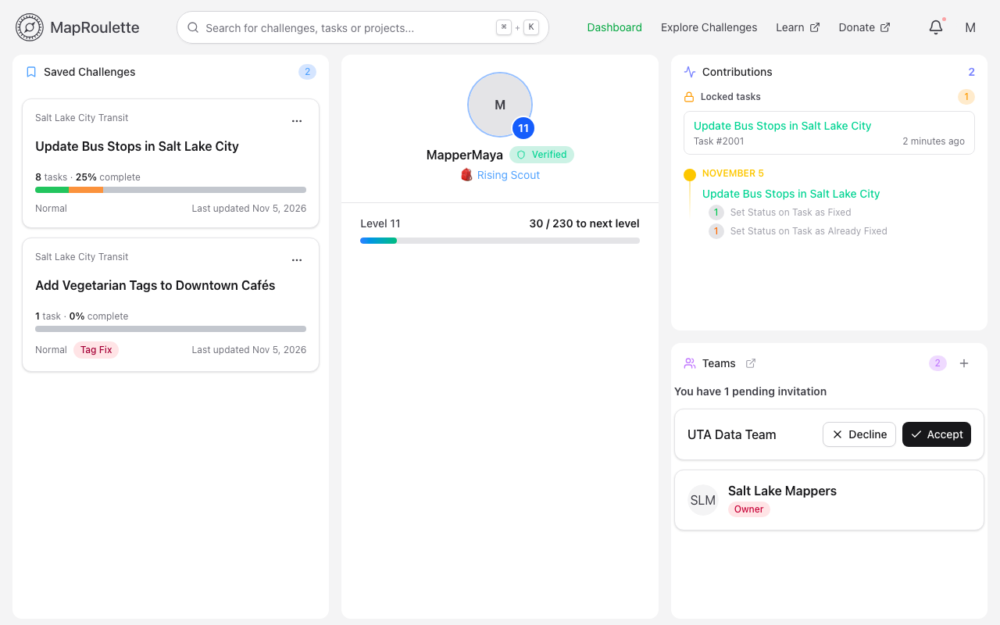
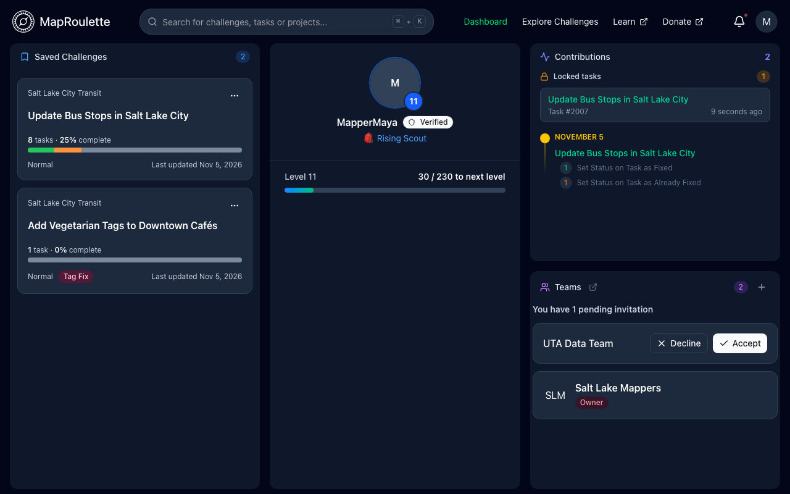
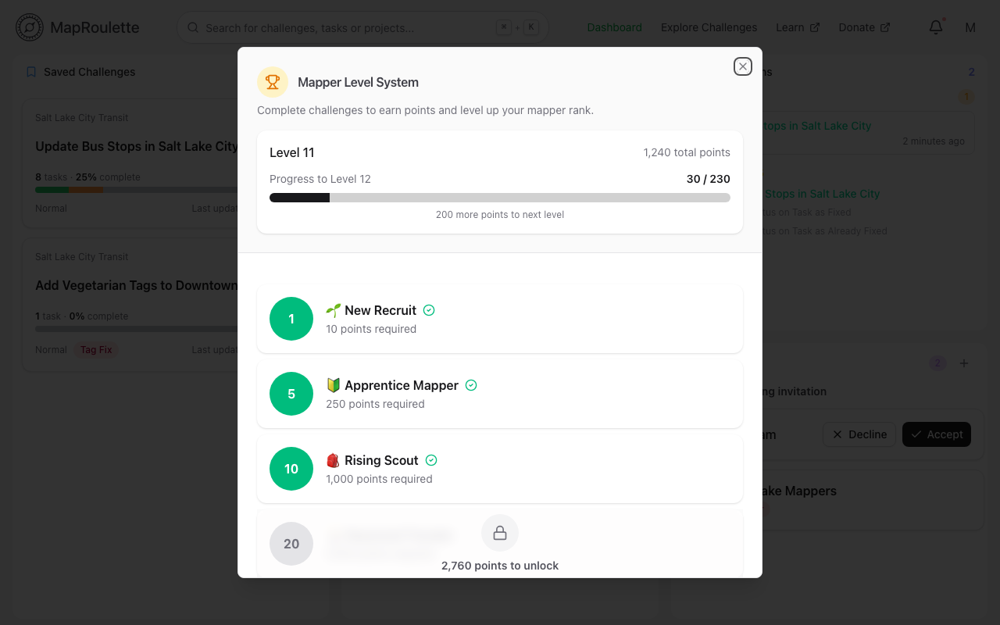
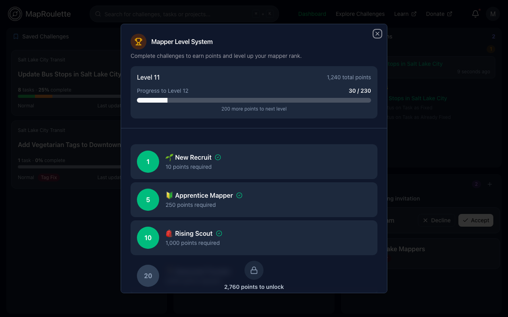

When signed into MapRoulette, you'll have access to your dashboard from **Dashboard** in the top navigation. In the dashboard you can view your saved challenges, current level, recent activity, and the teams you are in.

{: .only-light}
{: .only-dark}

## Saved Challenges

Challenges you've saved show up here so you can easily pick up where you left off. You can save a challenge from its page, which you can find through [Explore Challenges](/documentation/discovering-challenges/).

## Your profile and level

Increase your level by completing tasks! Click your level to see how many points you need for the next one. See [Earning Points and Levelling Up](/documentation/point-scoring/) for how points are awarded.

{: .only-light}
{: .only-dark}

## Contributions

Any tasks you currently have locked are listed at the top, so you can jump back in to finish or unlock them. Below that, this section shows all of your personal recent contributions on Challenges.

## Teams

The teams you belong to, and any pending team invitations, are listed here. Learn more about [Managing Teams](/documentation/teams/).
