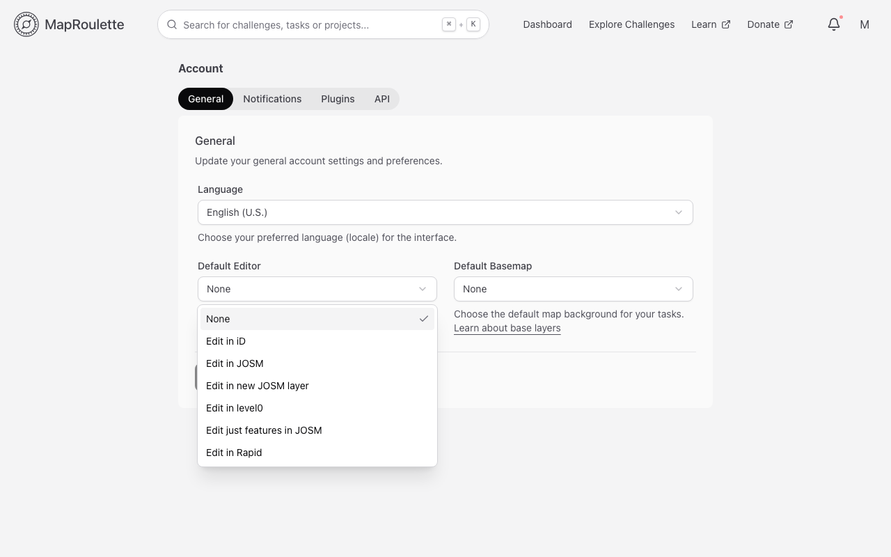
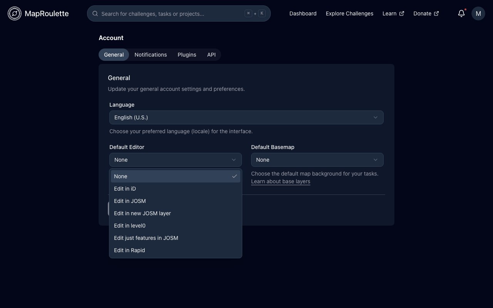
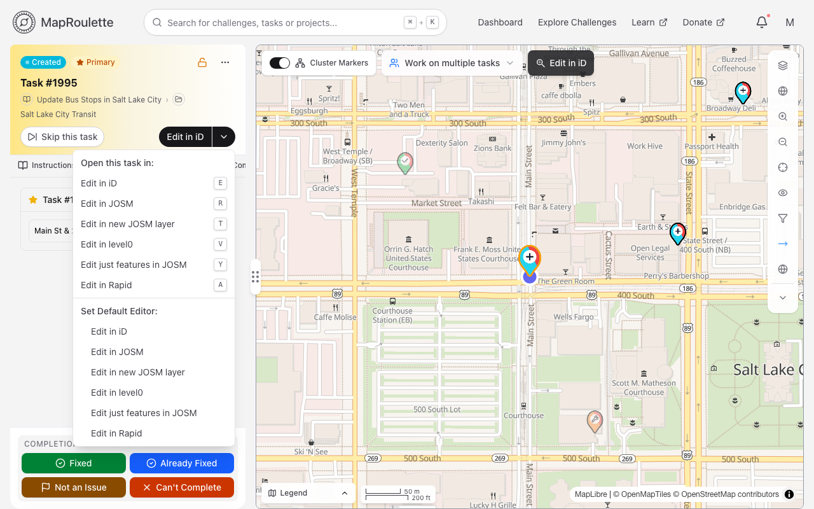
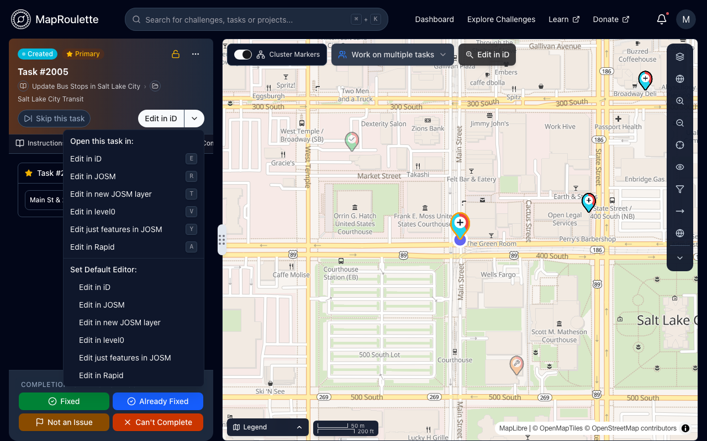

When you click _Edit_ in a Task, you are sent to an OSM Editor to edit OSM and resolve the task. Everyone has their own preference of OSM Editor, and you can set this preference in your [Account Settings](https://maproulette.org/settings), under **Default Editor** on the **General** tab.

{: .only-light}
{: .only-dark}

The available options are:

- Edit in iD
- Edit in JOSM
- Edit in new JOSM layer
- Edit in level0
- Edit just features in JOSM
- Edit in Rapid

Notice that for JOSM, you have three different options. You can load the data within the Task bounding box in the currently active data layer, or in a new data layer every time. Alternatively, you can load only the relevant OSM features, instead of all data in the bounding box. For any of the JOSM options, JOSM has to be running with [remote control](https://josm.openstreetmap.de/wiki/Help/Preferences/RemoteControl) enabled.

Remember to click **Save Changes** at the bottom of the tab, or your new default won't be applied.

Because many mappers use different editors based on the task at hand, MapRoulette also lets you set your preferred editor quickly in the Task screen:

{: .only-light}
{: .only-dark}

And finally, regardless of your selected editor, you can always use a [keyboard shortcut](/documentation/using-keyboard-shortcuts/) to open a specific editor during task completion.
