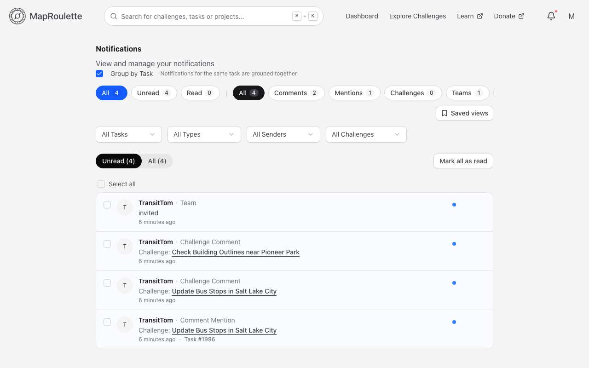
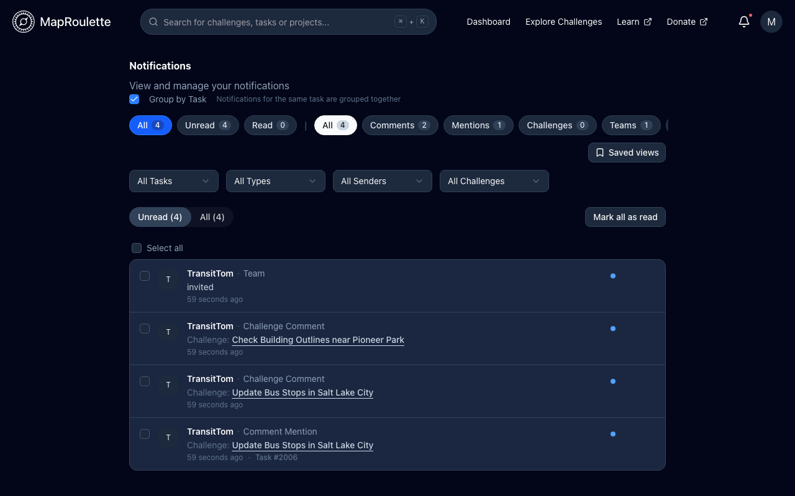
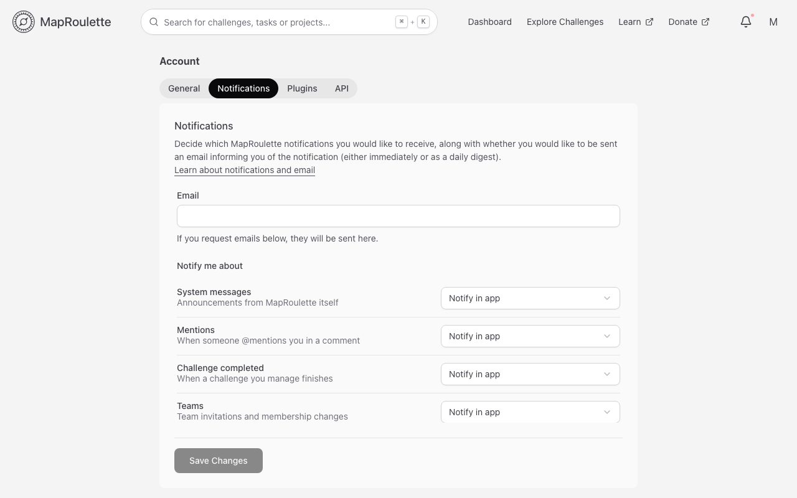
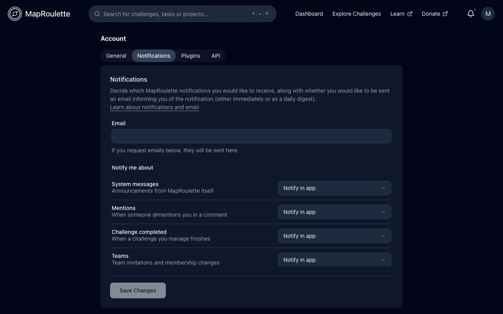

MapRoulette notifies you about events that may be important to you. The bell in
the header shows your unread notifications, with a dot when something is
waiting; **View all notifications** in that menu opens the full
**Notifications** page.

## What you get notified about

Notifications are grouped into these categories, which you can filter by on the
Notifications page (**All** shows every category):

- **Comments** — new comments on a challenge you manage.
- **Mentions** — someone mentioned you in a comment.
- **Challenges** — a challenge you manage or mapped on was completed, or
  someone asked you to unlock a task you have locked.
- **Teams** — team invitations and other team activity.
- **System** — important MapRoulette system events, like planned downtime.
  These are very infrequent. Notifications about task reviews are also listed
  here.

## Working through your notifications

{: .only-light}
{: .only-dark}

The Notifications page is a list with a filter bar and a reading pane:

- Filter by **type**, by **sender**, by **task**, and by read/unread state.
- **Group by Task** collapses every notification about the same task into one
  thread, which is the quickest way to deal with a busy task conversation.
- Selecting a notification opens the thread, showing the comments on that task,
  and lets you **reply** without leaving the page.
- Notifications can be marked read or unread — individually, for a whole
  thread, or for everything selected — and deleted.
- **Saved views** let you store a filter combination under a name and re-apply
  it later, so a routine such as "unread mentions" is one click away.
  Saved views live in your browser rather than on your account, so they don't
  follow you to another device.

## Email

Your email address is set on the **Notifications** tab of your
[account settings](/documentation/setting-your-default-osm-editor/)
(user menu → **Account Settings**). If you ask for notifications by email, they
are sent there.

MapRoulette does not require email validation, so please make sure that the
address you enter is valid and yours.

## Choosing what you're told about

{: .only-light}
{: .only-dark}

Under **Notify me about** on the same **Notifications** tab, you set each kind
of notification separately. The kinds you can set are **System messages**,
**Mentions**, **Challenge completed** and **Teams**. For each one you choose:

- **Ignore** — don't tell me at all
- **Notify in app** — a notification in MapRoulette, but no email
- **Notify and email immediately** — an email as soon as it happens
- **Notify and include in daily digest** — an email, batched into one a day

These are saved together with the rest of your account settings, by the
**Save Changes** button at the bottom of the tab.
