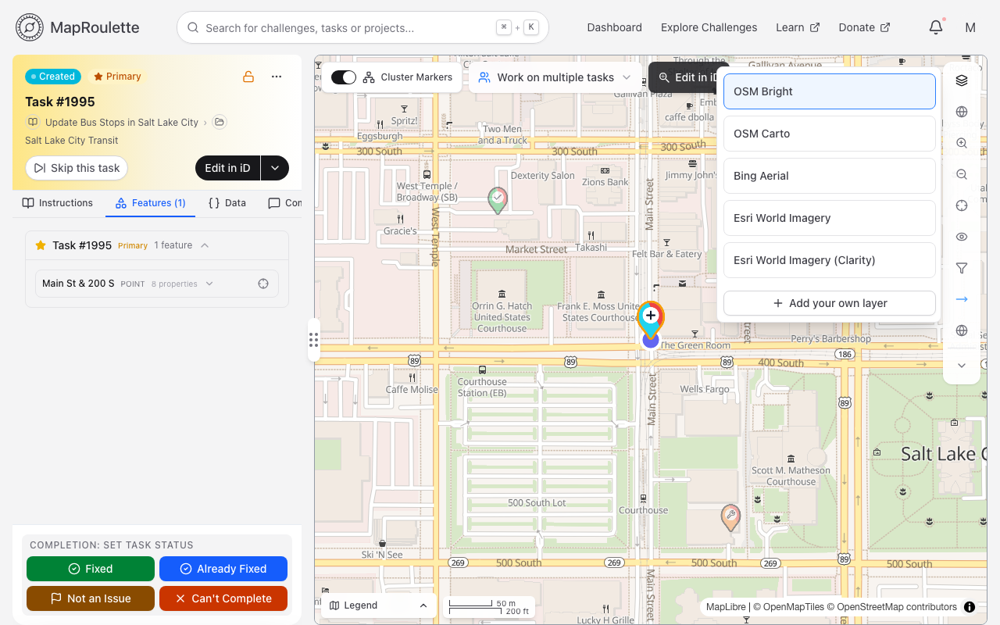
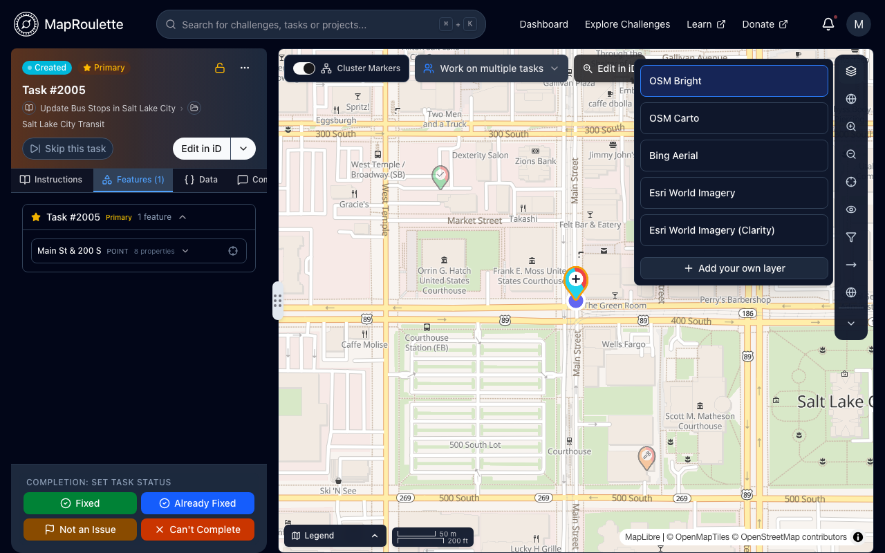
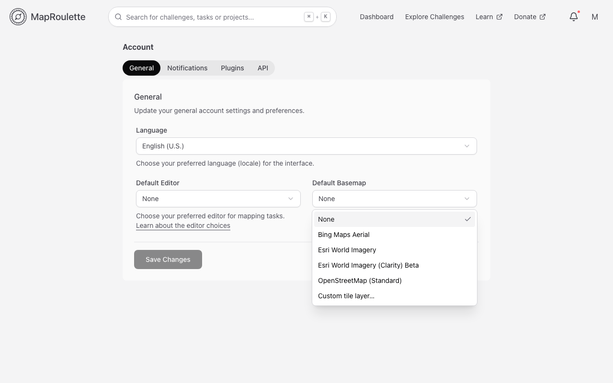
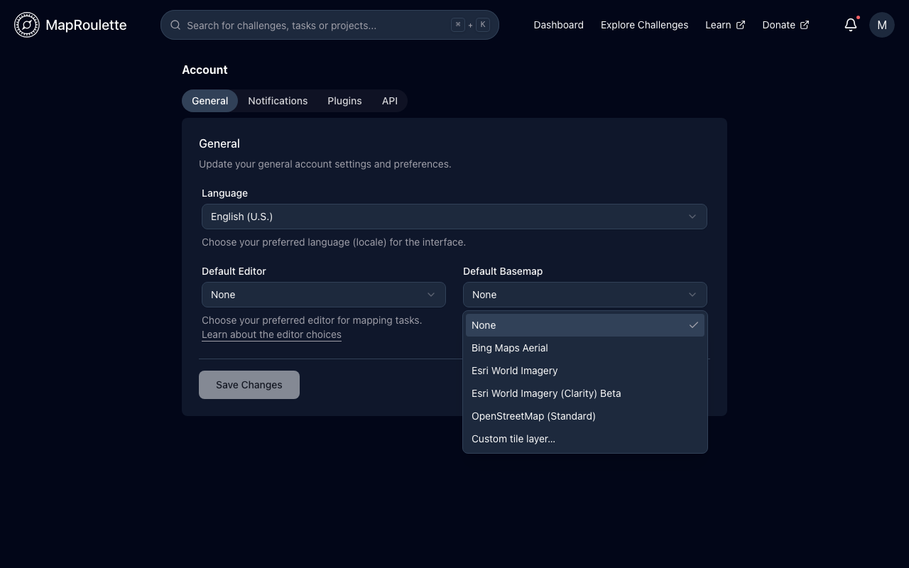
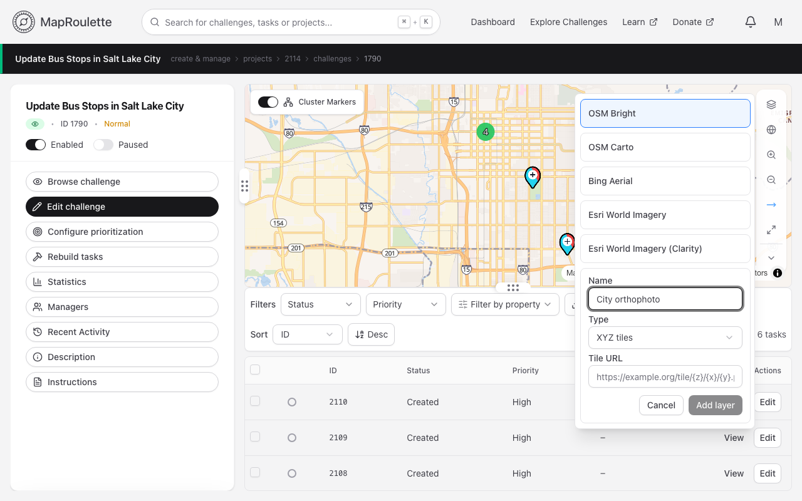
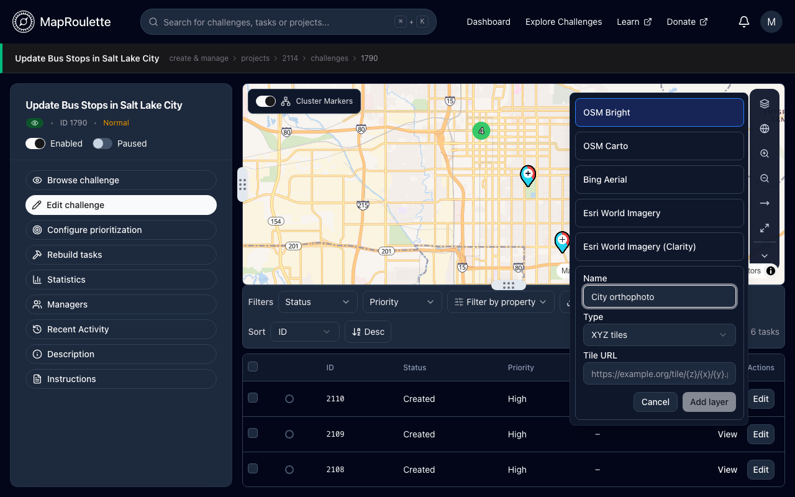

Depending on the type of Task and the geographical area you are working on, you may want to use a different base layer for the Task map. You can quickly switch between the available layers right in the **Map style** control:

{: .only-light}
{: .only-dark}

You can set your default choice for your preferred map base layer in your Account Settings, under **Default Basemap** on the **General** tab. Remember to click **Save Changes**.

{: .only-light}
{: .only-dark}

## Challenge Default

The creator of the Challenge you work on may set an appropriate base layer for the map, which will be selected by default when you start working on that Challenge. You can still override this in the **Map style** control.

## Custom base layers

_Advanced_

If you have a custom TMS tile layer source you want to use, you can select **Custom tile layer…** from the list in your Account Settings, and add the layer using the same URL pattern used [in QGIS](https://docs.qgis.org/3.22/en/docs/user_manual/managing_data_source/opening_data.html#using-xyz-tile-services) and [Leaflet](https://leafletjs.com/reference.html#tilelayer), for example:

`https://tiles.somewhere.com/blabla/{z}/{x}/{y}.png`

You can also choose **Add your own layer** in the **Map style** control to add an XYZ or WMS layer. Layers you add there are saved to your account and only you can see them.

{: .only-light}
{: .only-dark}
