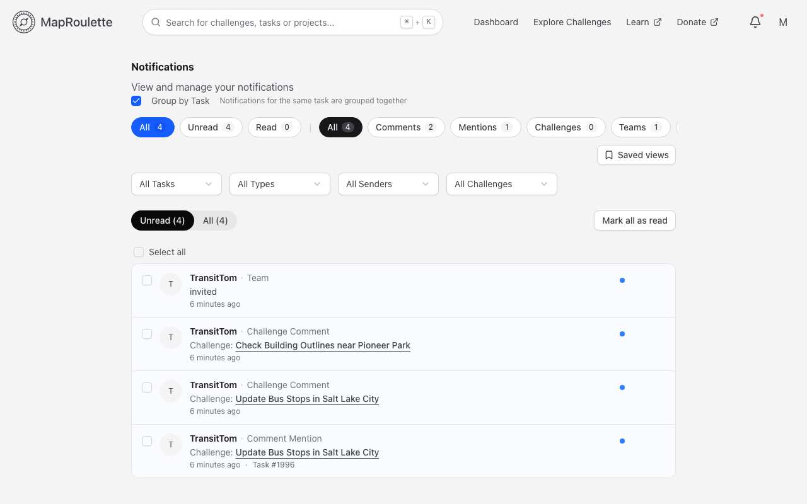
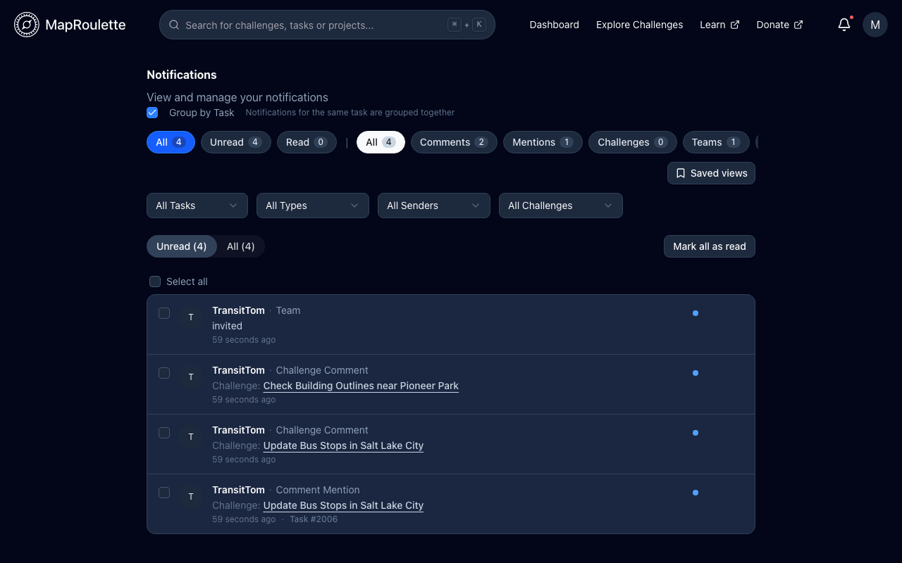
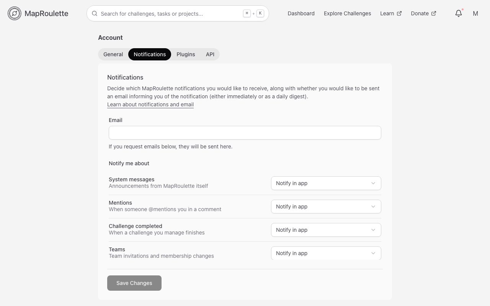
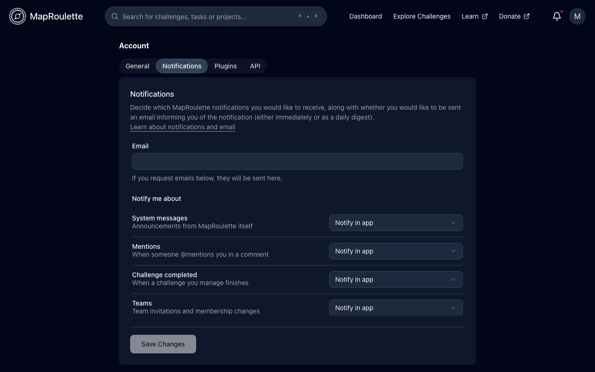

You can now get notified of events in MapRoulette that may be important to you. The notifications will show up in the bell menu in the header. If you have new notifications, there will be a red dot. Click **View all notifications** to open the Notifications page, where you can filter, reply to and manage them:

{: .only-light}
{: .only-dark}

Currently, MapRoulette will notify you about the following things:

- **System messages** — important MapRoulette system events, like planned downtime. These will be very infrequent.
- **Mentions** — Be notified when someone mentions you in a comment.
- **Challenge completed** — Be notified when a challenge you manage is completed.
- **Teams** — Be notified about team invitations and other team activity.

You can set individual notification preferences for each of these on the **Notifications** tab of your Account Settings. There are four notification levels:

1. **Ignore** — no notification whatsoever
2. **Notify in app** — you will see the notification in MapRoulette, but no emails are sent
3. **Notify and email immediately** — you will see the notification in MapRoulette, and an email will be sent to the address in your Account Settings as the event happens
4. **Notify and include in daily digest** — you will see the notification in MapRoulette, and the notification will be added to a daily email digest that will be sent to the address in your Account Settings

{: .only-light}
{: .only-dark}

Remember to click **Save Changes** at the bottom of the tab.

Right now, MapRoulette does not require email validation, so please make sure that the email address you enter is valid and yours.
